# Reader

Reader is a local-first reading app for a folder of Markdown and PDF documents
kept in Git, which Reader calls a *vault*. It gives that folder a quiet,
keyboard-driven reading website with margin notes, search that understands
meaning, a record of what changed since you last read something, and a chat
panel where AI voices can discuss the page with you.

Reader has no hosted service, no account and no analytics. The AI parts are
bring-your-own: Reader runs the command-line tools you already pay for (Claude
Code, Codex, agy) or a model you run locally (LM Studio, Ollama, llama.cpp or any
OpenAI-compatible server), and everything works without them.

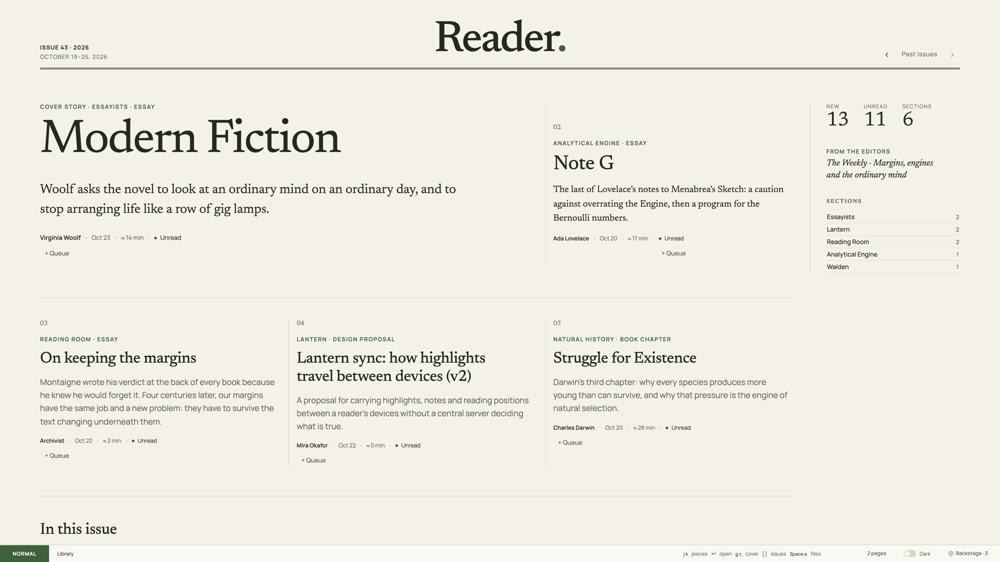

The code lives here. Your documents live in a separate vault repository that this
repository never contains. The Python backend runs on macOS and Linux; Windows is
not supported.

## A tour

### Reading

The homepage is this week's issue: a cover story, a few features from different
projects and a contents list, drawn from what arrived this week with unread pieces
first. Open a piece and long documents get an outline rail that follows your
section. Mermaid diagrams are drawn locally by Pele and follow the theme, and TeX
math is typeset by KaTeX. Obsidian callouts render as asides.

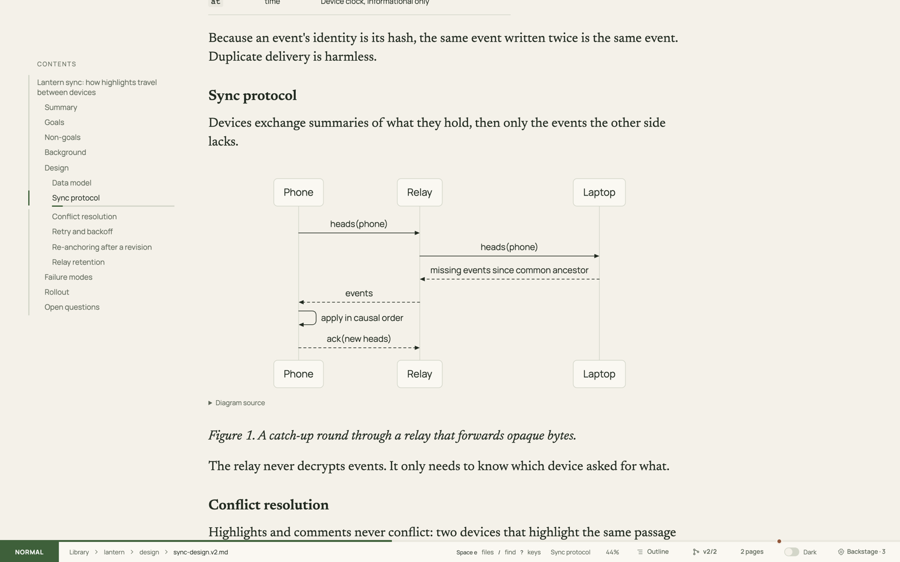

Choose **2 pages** for facing-page reading. Spreads turn with a Three.js page curl,
which falls back to a slide without WebGL or with reduced motion. Your place is
saved automatically in both layouts.

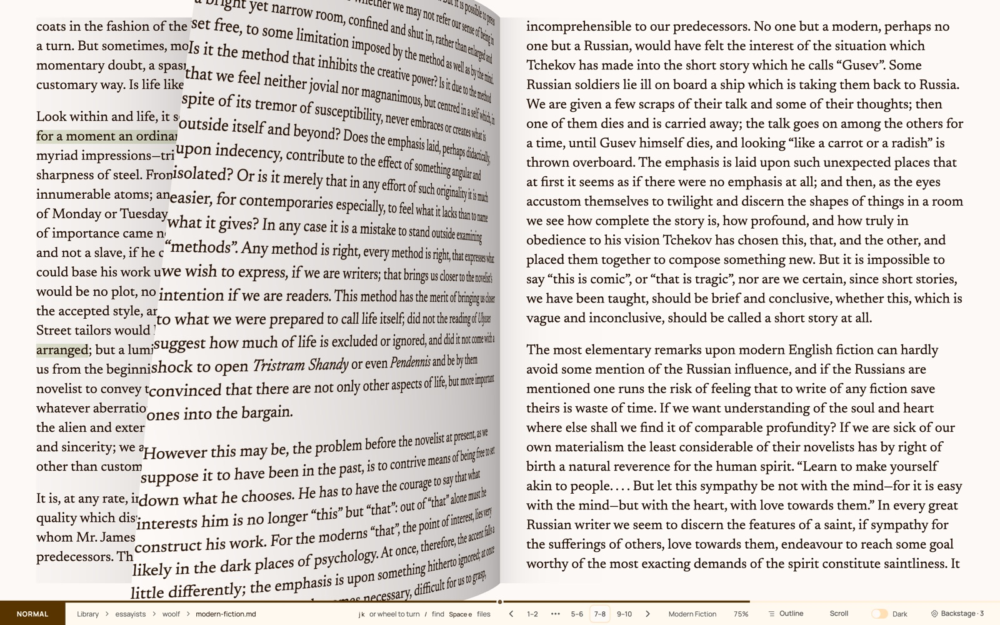

### In the margins

Select a passage to highlight it, comment on it or raise a warning (a red wavy
underline with an explanation). Threads are shared: you, an agent working through
the MCP tools, and the Obsidian sidebar all read and write the same ones, and each
participant has their own read receipts.

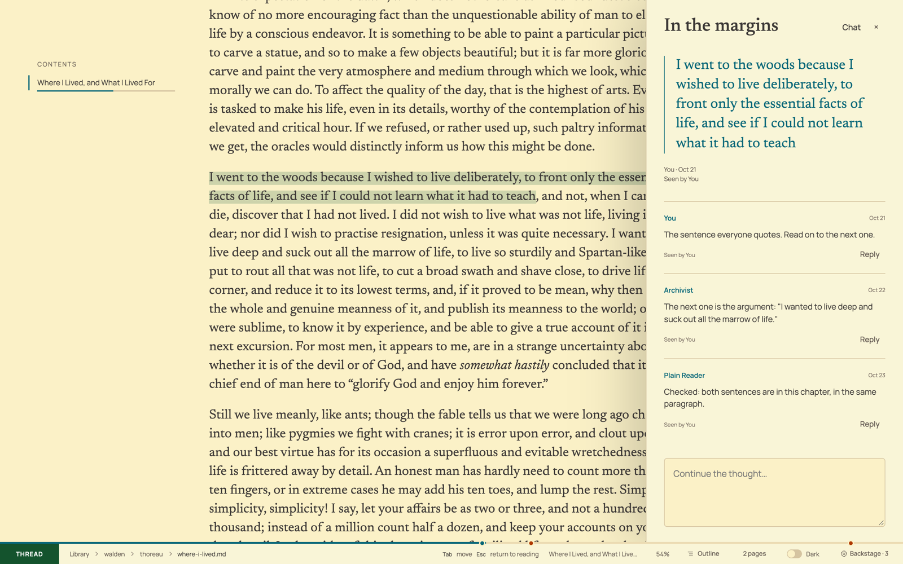

### What changed since you read it

Reader knows which edition you read. When a document has changed, a banner says so
and a panel shows a paragraph and word diff against the exact bytes you read,
recovered read-only from the vault's Git history, including where your highlights
now sit. **Space v** opens a version explorer with every edition and its commits;
any commit can be opened read-only or compared with another.

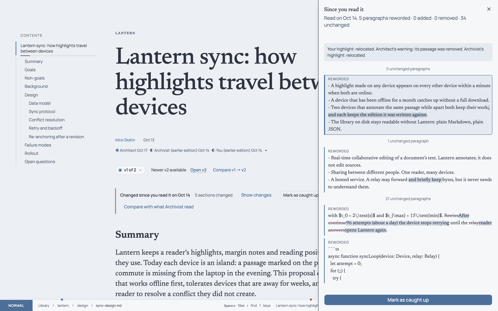

### Search and Read next

**Space /** opens a search page that returns passages, not just titles, ranked by
exact words, meaning, or a blend of both, with Project, Author and Type facets.
Embeddings are computed on your machine (FastEmbed with bge-small, or an embedding
model on your local model server). Hovering a link previews its target, and each article ends with
**Linked from** and up to three **Read next** suggestions with their reasons.

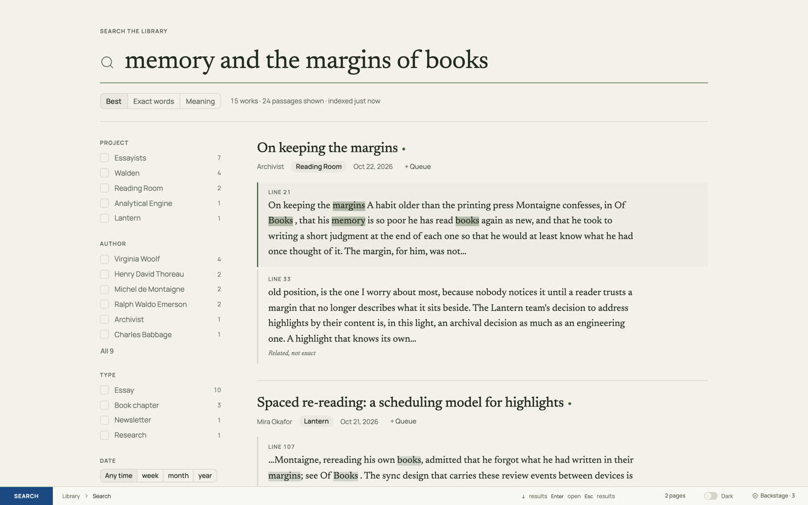

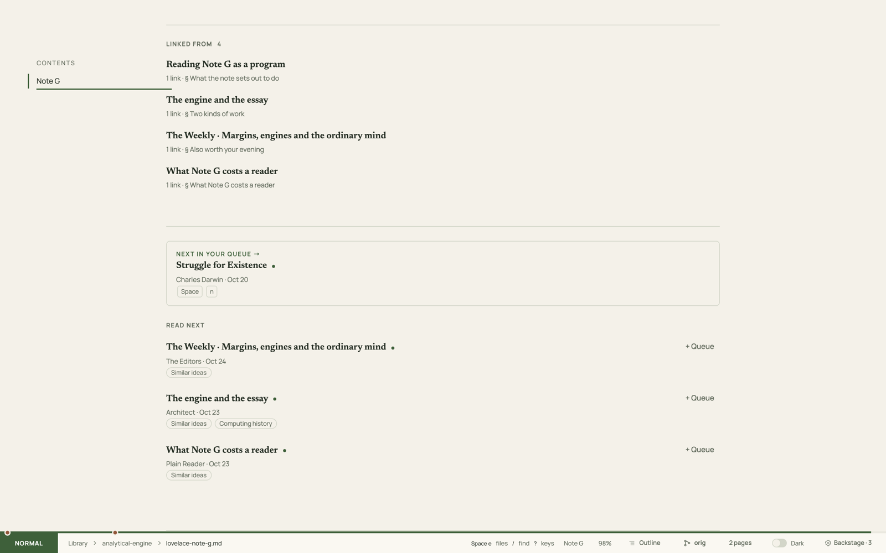

A reading queue (**Space r**) works like a play queue, and History lists what you
opened by day with progress and resume.

### Chat with the voices

**Space m** opens a chat about the open document. You decide who answers with `@`
mentions; each voice is a CLI you configure in the vault's `voices.json` (Claude
Code, Codex, agy, or any command that prints text). After an addressed exchange,
the other voices can raise a hand to add something, and you choose whether to let
them speak. Replies stream into the panel, each chat is committed to the vault, and
every turn's prompt and raw output are archived in `logs/llm/` so you can see
exactly what was sent and returned.

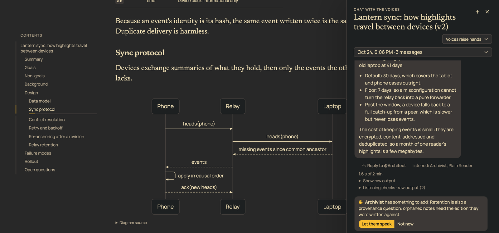

### Prose colors

**Space c** highlights the grammar of the text with the optional
[Colorful Language](https://github.com/flyingrobots/colorful-language) CLI, from a
subtle fade of function words to every grammatical role in its own color. The text
itself never changes; the colors are derived per theme to keep their contrast.

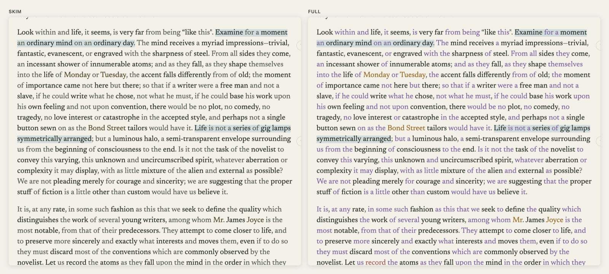

### Themes

Reader ships 22 built-in themes: Ink/Paper, Orchid and Harvest, and light and dark
pairs of Solarized, Gruvbox, Catppuccin, Nord, Dracula, Rosé Pine, Tokyo Night and
One. The Theme Editor (**Space , t** or F10) makes your own, from scratch or from a
seed color, and checks WCAG 2.2 text contrast and simulated color-vision separation
as you edit. The checks are aids, not an accessibility certification.

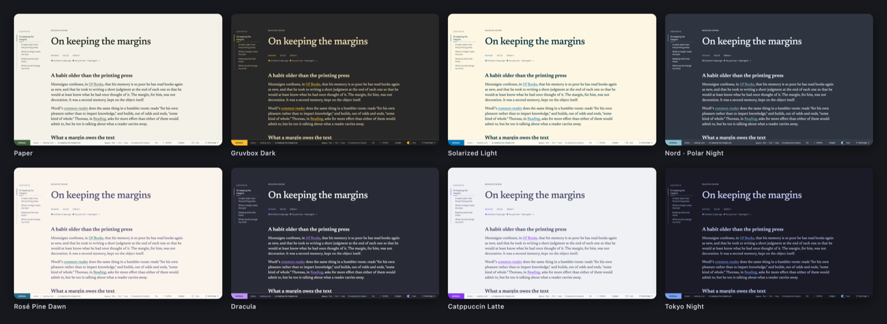

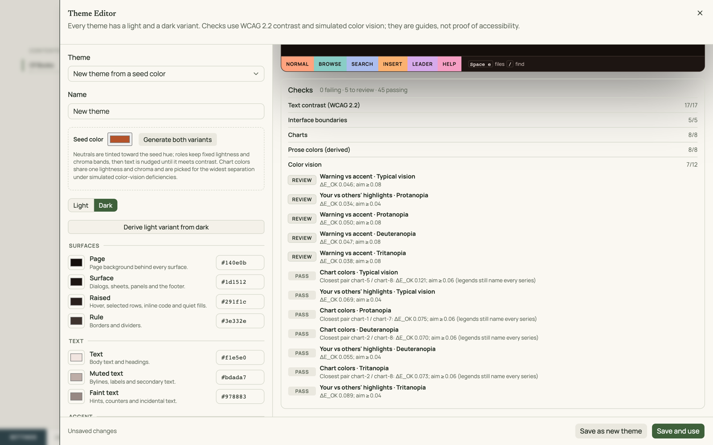

### Behind the scenes and the inbox

**Space p** opens Behind the scenes: the freshness of the search index, browse
indexes, catalog mirror and link graph, with rebuilds on demand; library
statistics; settings; and the local-model provider, queue and controls. Other tools and
agents deliver documents into the vault's `inbox/` with `reader ingest` or the
`reader_ingest` MCP tool. **You got mail** then starts a librarian run through your
own Codex CLI, which files the arrivals, and you can watch its live transcript
through to the verified commit.

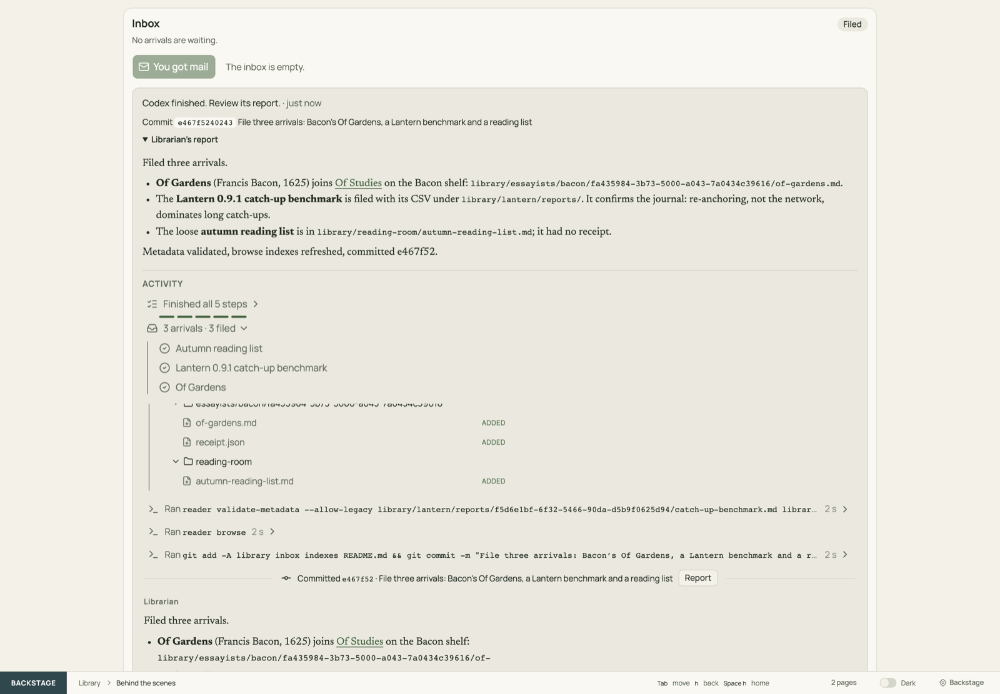

Other parts, each documented in [docs/web.md](docs/web.md): **Send to AI-TTS**
(Space s) hands the article or a selection to a local AI-TTS speech daemon; a
reading log under each title shows who has read this edition; the app works at
phone width and can be added to a home screen.

## Quick start

You need Python 3.11 or newer, [uv](https://docs.astral.sh/uv/) and Git.

```sh
git clone https://github.com/flyingrobots/reader.git
cd reader
uv sync --locked
```

### Try the demo

Try it on a ready-made example library first:

```sh
uv run --locked reader demo --open
```

This builds a disposable demo vault in `~/Reader Demo` (public-domain essays and a
fictional software project, with highlights, threads, editions, a reading queue,
inbox arrivals and chat with scripted voices that need no AI), indexes it, and
opens the reader in your browser. Ctrl-C stops it; run it again to refresh the
dates. It never touches a folder that is not an earlier demo. See
[the demo vault](docs/demo.md) for options and sources. `reader demo --export-static DIR`
writes the same library as a static website that runs entirely in the browser; see
[static web demo](docs/demo.md#static-web-demo).

When you are ready for your own documents: a vault is a Git repository with `library/` and `inbox/` folders. Put your Markdown
and PDF files anywhere under `library/`:

```sh
mkdir -p ~/my-vault/library ~/my-vault/inbox
cd ~/my-vault && git init
```

Run the web reader and open <http://127.0.0.1:8766>:

```sh
uv run --locked reader --root ~/my-vault web
```

The server binds to loopback only. To build the search index (the first run
downloads a small embedding model into the vault's `.reader/`):

```sh
uv run --locked reader --root ~/my-vault index
uv run --locked reader --root ~/my-vault index --no-semantic   # keyword and fuzzy only, no download
```

To install the MCP server and agent skills for Codex and record the vault for
`scripts/start_web.py`, run `python3 scripts/install.py --vault ~/my-vault`. It
requires `codex` on your PATH; other MCP clients can be pointed at the stdio
server by hand. The Obsidian sidebar plugin is optional. Both are covered in
[separate-vault setup](docs/separate-vault.md), [delivery](docs/delivery.md) and
[the Obsidian plugin](docs/obsidian-plugin.md).

### Companion projects

For the full experience, install these sibling projects as well. Each is a
separate repository, not a package dependency, so `uv sync` does not fetch them;
Reader finds them on your PATH and works without them. **Behind the scenes,
Companions** shows each one's status; when a feature needs a missing companion, Reader
says so and offers setup, and it can build Colorful Language and wide-md for you
([details](docs/web.md#behind-the-scenes-companions)).

| Project | What it adds | Install |
| --- | --- | --- |
| [AI-TTS](https://github.com/flyingrobots/AI-TTS) | Read aloud (Space s): a local speech daemon that queues speech, keeps history and honours pauses | Follow its README; Reader talks to the running daemon |
| [Colorful Language](https://github.com/flyingrobots/colorful-language) | Prose colors (Space c): syntax highlighting for English prose | **Install** in Behind the scenes, Companions (builds the pinned release; needs Rust), or `cargo install --path crates/colorful-cli --locked` in a clone and **Set path** there |
| [wide-md](https://github.com/flyingrobots/wide-md) | Reading copies: removes artificial line wrapping from filed Markdown | **Install** in Companions, or `python3 scripts/install_wide_md.py`; both build the pinned revision ([details](docs/reading-copies.md)) |
| [git-locks](https://github.com/git-stunts/locks) | Safe commits when several agents or Reader processes write to the vault at once | Follow its README so `git-locks` is on your PATH (Companions shows the commands); without it Reader coordinates only its own processes with local file locks |

### Optional connections

| To get | Install | Then |
| --- | --- | --- |
| Chat voices | Any of `claude`, `codex` or `agy`, signed in with your own account | Copy [`templates/voices.json`](templates/voices.json) into the vault and edit it ([voice registry](docs/web.md#voice-registry)) |
| Inbox librarian | `codex`, signed in (`codex login`) | Press **You got mail** in Behind the scenes ([inbox runner](docs/inbox-runner.md)) |
| Local model | Any OpenAI-compatible server: [LM Studio](https://lmstudio.ai/) (Reader can start it and load models through `lms`), [Ollama](https://ollama.com/), llama.cpp's `llama-server`, vLLM, LocalAI, Jan | Behind the scenes, Local model, Provider: pick a preset or enter its `/v1` base URL ([details](docs/web.md#behind-the-scenes-local-model-any-openai-compatible-server)) |
| Read aloud | A local [AI-TTS](https://github.com/flyingrobots/AI-TTS) daemon | Space s ([details](docs/web.md#send-to-ai-tts)) |
| Prose colors | [Colorful Language](https://github.com/flyingrobots/colorful-language) 0.3.0 or newer | Space c ([details](docs/web.md#prose-colors-colorful-language)) |

The local model writes standfirsts and key terms, checked against the source and
cached outside your documents, and can serve search embeddings. Presets fill the
usual addresses (LM Studio `http://127.0.0.1:1234/v1`, Ollama
`http://127.0.0.1:11434/v1`, llama.cpp `http://127.0.0.1:8080/v1`); models are found
with `GET /v1/models`. Servers other than LM Studio you start yourself. Only
addresses on this machine are accepted unless you turn on **Allow a server on
another machine**, and Reader then says plainly that document text leaves it. An
optional API key goes in `READER_LLM_API_KEY` or a git-ignored, owner-only file and
is never shown or logged. Chat voices use the CLIs above, not the local model.

## Privacy and the AI model

- **Local first.** Documents, highlights, receipts, chats, themes and indexes live
  in your vault. Browser assets and fonts are served locally; there is no runtime
  CDN and no analytics.
- **Bring your own subscription.** Reader has no AI account of its own, and stores
  no API key except an optional one for your local-model server, kept out of git. A voice turn runs the CLI you configured, with that CLI's account and
  the authority you gave it in `voices.json`. The template lets voices read, write
  and commit in the vault, so review it before you copy it.
- **What leaves your machine.** A voice turn sends the document's identity, the
  chat transcript and whatever the voice chooses to read to that CLI's provider
  (Anthropic, OpenAI or Google). The built-in embedding model runs locally, and so
  does the local model unless you explicitly allow a server on another machine, in
  which case Behind the scenes shows that the text of queued documents is sent there.
- **Logs are kept.** Every chat turn's prompt, output and metadata are archived in
  the vault under `logs/llm/` and committed with the chat. Nothing prunes them, and
  a new turn will not start when the disk is low enough that its log could not be
  kept.
- **Not a multi-user server.** Participant names are labels for attribution, not
  accounts. Use the Tailscale option below rather than exposing the port.

## Keyboard basics

Reader is built for the keyboard, with Vim-style motions. Press **?** for the full
map.

| Keys | Action |
| --- | --- |
| Space e | Documents browser |
| Space / | Search page |
| j / k, gg / G | Scroll (or turn spreads); beginning / end |
| ]] / [[ | Next / previous heading |
| Space o | Document outline |
| Space h / t / p | Home / passage discussions / Behind the scenes |
| Space m | Chat with the voices |
| Space r, Space n | Reading queue, open the next item |
| Space v, Space d | Versions, what changed |
| Space c | Prose colors |
| Space z | Hide or show reading chrome |
| Escape | Close the current panel |

## Always-on service

On macOS, `scripts/reader_service.py install` runs the web reader as a LaunchAgent
from a dedicated worktree. Every ten minutes an updater moves it to the newest
commit on the source branch, but only after that commit passes a smoke test, and
rolls back if the restarted server is unhealthy. It waits while inbox runs or index
rebuilds are active. `scripts/reader_service.py tailscale on` publishes it on your
own tailnet with `tailscale serve` (never Funnel), admitting only allow-listed
Tailscale logins. `status`, `pause`, `resume`, `restart` and `uninstall` do what
they say. See [Always-on service and Tailscale](docs/web.md#always-on-service-and-tailscale).
Linux service units are not provided.

## Delivery from another machine

Agents on another of your computers can deliver into the vault's inbox over SSH,
without the Reader environment or a vault there. This is optional and off by
default: nothing listens on the network until you run
`python3 skills/reader/scripts/reader.py remote-setup user@vault-host` on the
delivering machine. Setup creates a dedicated key and authorizes it on the vault
machine with a restricted forced command, limited to delivery and receipt status
unless you choose `--scope library` for search and reading too. See
[remote delivery over SSH](docs/delivery.md#remote-delivery-over-ssh).

## Documentation

- [Web reader](docs/web.md): every feature, key, limit and recovery step
- [Demo vault](docs/demo.md): `reader demo`, its contents, sources and scripted voices
- [Capabilities and boundaries](docs/capabilities.md): what is and is not supported
- [Search](docs/search.md), [annotations](docs/annotations.md),
  [delivery](docs/delivery.md), [metadata](docs/metadata.md),
  [browse indexes](docs/browsing.md)
- [All documentation](docs/index.md), [changelog](CHANGELOG.md),
  [roadmap](planning/roadmap.md)

## Development

Tests use synthetic fixtures and never open your vault or run a real model CLI;
stand-ins such as `tests/fake_voice.py` and `tests/fake_lmstudio.py` take their
place.

```sh
uv sync --locked
uv run --locked pytest -q
node --test tests/*.test.mjs
```

The browser suites (`tests/web_*.cjs`) drive a disposable fixture server with
Playwright and Chrome:

```sh
READER_PLAYWRIGHT=/absolute/path/to/playwright-core \
READER_CHROME=/path/to/chrome node tests/web_browser.cjs
```

The full list is in [Development and validation](docs/web.md#development-and-validation).
CI runs the Python and plugin checks in bounded Docker workers through
`scripts/check_container.py`, which you can run locally too
([bounded validation](docs/separate-vault.md#bounded-validation)).

The backend is a Python standard-library web server (`src/reader_mcp/web.py`) with
plain-JavaScript reading modules in `src/reader_mcp/web_ui/`. A small React and
Base UI controls layer is built from `web/`; its compiled assets are checked in, so
you only need Node to change those controls (`npm ci && npm run build` in `web/`).

## Contributing

Issues and pull requests are welcome at
[flyingrobots/reader](https://github.com/flyingrobots/reader). Keep each pull
request to one change that can be checked on its own, include tests built on
synthetic fixtures, and update the relevant page under `docs/` when behavior
changes. Never include private documents, vault content or machine-local paths in
code, issues or test evidence.

## License

Reader is licensed under the [Apache License 2.0](LICENSE). The license covers this
software only; documents in your vault keep their own rights and attribution.
Vendored browser dependencies keep their [own licenses](THIRD_PARTY_NOTICES.md).
