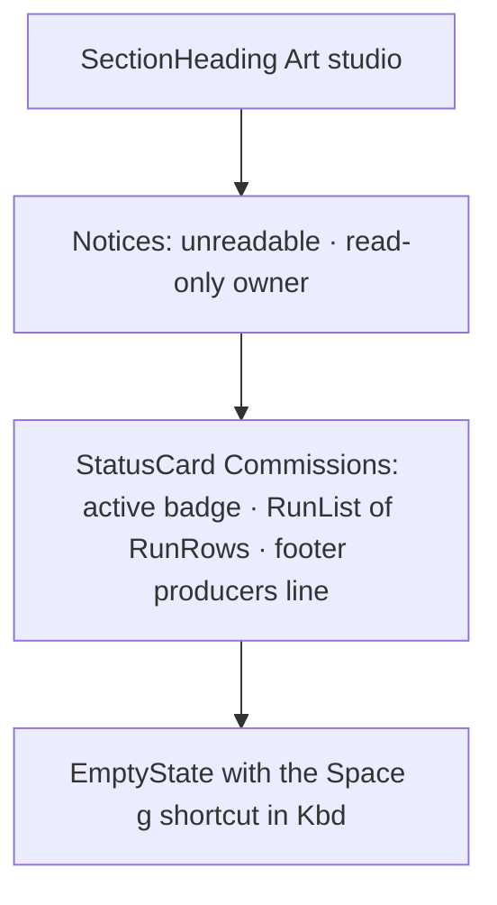

# Design sheet: Admin › Artwork

Route `#admin/artwork`. Source: `web/src/art-studio.tsx` (`ArtStudio`). Generating art from an article stays in the article view (`art-regenerate.tsx`) and is out of scope.

## Focused activity

**See which art commissions are running, waiting or finished, what each cost, and cancel or open one.** An agent writes an art brief and a scene, and Reader validates the scene and draws it. Each run is archived and each version committed. The page answers these questions:

1. Is anything making art right now, and how far along is it?
2. How did recent commissions end (Ready, Failed, Timed out, Cancelled), how long did they take, and what did they cost?
3. Who can make art here, and which producer is the default? (The choice itself is in Settings.)

When another Reader server owns art for this vault, the page is read-only and says so.

## Layout

## Atomic composition

| Tier | Parts |
| --- | --- |
| Atoms (shadcn) | `Button`, `Badge`, `Kbd`, `Spinner` |
| Atoms (theme) | `StatusBadge` (Making = active, Ready = ok, Failed / Timed out = error, Queued / Waiting / Cancelled = neutral), `RunStateIcon`, `SectionHeading` |
| Molecules | `RunRow` (state icon, title, producer and model, duration and cost, archive path, error, Cancel or Open), `Notice`, `EmptyState`, `LoadingState`, `Unavailable` |
| Organisms | `StatusCard`, `RunList` |
| Template | `AdminPage` |
| Page | `ArtStudio` binds `api` and `open` |

## Test hooks

`#backstage-art`, `[data-art-job=<id>][data-job-state]` (with its Cancel and Open buttons), `[data-art-read-only]`.
