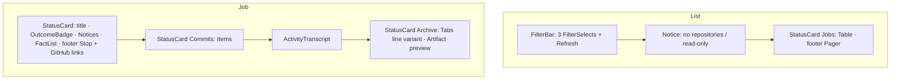

# Design sheet: Admin › Coding jobs

Routes `#admin/jobs` (the list) and `#admin/jobs/<uuid>` (one job). Source: `web/src/admin/pages/jobs.tsx`. The article prompt card's compact `JobSummary` stays in `web/src/jobs/job-detail.tsx`.

## Focused activity

**List:** *find the job I care about and see how it ended.* Filter by repository, state or article. Each row says what ran, where, with which agent, when, and what came of it (a PR link or the outcome message).

**One job:** *understand what the agent did and whether to trust the result.* The page shows the outcome and its GitHub links, the facts that pin the run (branch, base, head, worktree, verification), the commits, the full trace, and the archived artifacts. Stop is the only action, and only for an active job this server owns.

## Layout

On a phone the filters stack to full width, and the table scrolls horizontally inside its card, never the page. Artifact tabs wrap.

## Atomic composition

| Tier | Parts |
| --- | --- |
| Atoms (shadcn) | `Button` (link Buttons render `<a>`), `Badge`, `Spinner`, `Select`, `Table`, `Tabs` |
| Atoms (theme) | `StatusBadge` through `OutcomeBadge` (PR opened / already fixed = ok, cancelled = neutral, others = error, running = active) |
| Molecules | `FilterSelect`, `FilterBar`, `Pager`, `Notice`, `FactList`, `LoadingState`, `EmptyState`, `Unavailable` (shared with LLM logs and Repositories) |
| Organisms | `StatusCard`, `ActivityTranscript`, `Artifact` |
| Template | `AdminPage` |
| Pages | `JobsPage`, `JobPage` |

## States

| State | What shows |
| --- | --- |
| Static demo | a `Notice`: coding jobs need Reader on your computer |
| Read failed | destructive `Notice` with `role=alert` |
| No jobs, no filters | `EmptyState` saying how a job starts |
| No match | a muted table row, *No coding jobs match.* |
| No registered repository | a `Notice` with a button to Repositories |

## Test hooks

`[data-admin-panel=jobs|job]`, `[data-job-row=<id>]`, `[data-job-outcome]`, `[data-job-stop]`, `[data-job-artifact=<name>]`, `[data-filter=jobs-repo|jobs-state|jobs-article]`, `[data-pager]`.
