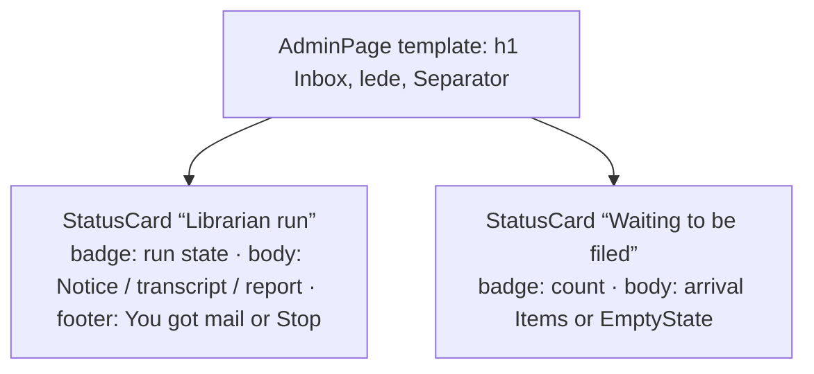

# Design sheet: Admin › Inbox

Route `#admin/inbox`. Source: `web/src/admin/pages/inbox.tsx`.

## Focused activity

**Decide whether to file the mail now, then watch the librarian do it.** You come here because the footer says
*Backstage · 3*. The page answers three questions in this order:

1. What is waiting, and is each arrival intact (receipt checked against the delivered bytes)?
2. Can I file it now, and if not, why not (blocked by a claim, no Codex, the static demo)?
3. While it runs and after it finishes: what is the librarian doing, what did it commit, and what did it report?

Previewing an arrival is reading, not filing. It writes no receipt, bookmark or discussion.

## Layout

The run card comes first because it holds the page's one primary action. On a phone both cards span the full width. The arrival list keeps to one column at every width, so titles are never cut off.

## Atomic composition

| Tier | Parts |
| --- | --- |
| Atoms (shadcn) | `Button`, `Badge`, `Spinner`, `Separator`, `Collapsible` |
| Atoms (theme) | `StatusBadge` (run state, receipt integrity), `RelativeTime`, `Elapsed` (clock) |
| Molecules | `Notice` (blocked, failed, finished message), `EmptyState` (nothing waiting), `LoadingState`, `Unavailable`; shadcn `Item` for one arrival (`render` as a `<button>`) |
| Organisms | `StatusCard` ×2; shadcn `ItemGroup` of arrivals; the existing `ActivityTranscript` (Trace and Message composition) |
| Template | `AdminPage` inside the Admin shell (`Sidebar`, `AdminHeader` with `Breadcrumb`) |
| Page | `InboxPage` binds `context.inbox`, `startInbox`, `stopInbox`, `open` |

## States

| State | What shows |
| --- | --- |
| Loading | `LoadingState` in both cards; You got mail disabled |
| Unreadable | `Unavailable` (destructive Alert) with the error; never an empty list |
| Nothing waiting | `EmptyState` with the inbox icon; the button stays, and the note says why it would do nothing |
| Blocked | a `Notice` (destructive for interrupted, error or Codex; default for a claim or an empty inbox) with `data-reason` |
| Running | badge *Librarian reading* with Spinner; elapsed clock; live transcript; Stop (outline, destructive text) |
| Finished, failed or stopped | a `Notice` with the run message and time; commit line; the report in a `Collapsible`, open after success |

## Theme and tokens

Only semantic utilities are used (`bg-card`, `text-muted-foreground`, `text-destructive`, `border-border`). They resolve to Reader theme tokens through `@theme inline` in `web/src/styles.css`, so every built-in, famous and custom theme applies. The sanitized report keeps its own prose styles (`.inbox-report`), because it is rendered Markdown and not a component.

## Test hooks

`#inbox` (the page wrapper: `data-state`, `data-run-state`), `#inbox-mail`, `#inbox-mail-note`, `#inbox-stop`, `#inbox-blocked[data-reason]`, `#inbox-run-message`, `#inbox-report`, `[data-arrival]`, `[data-arrival-title]`, `[data-integrity]`, `[data-inbox-badge]`, `[data-run-clock]`.
