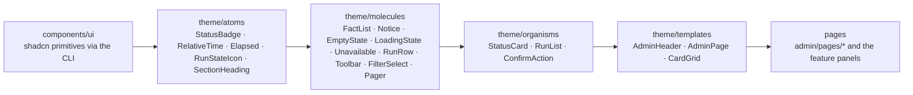

# Reader Admin design sheets

Each Admin page has a design sheet. A sheet states the page's focused activity (the one job you come to it for), its layout, how it is composed from shadcn components through Reader's atomic tiers, its states, and the hooks its tests use. The component system itself is described in [Library website › Component system](../web.md#component-system).

| Page | Route | Sheet |
| --- | --- | --- |
| Overview | `#admin` | [overview.md](overview.md) |
| Coding jobs | `#admin/jobs` | [coding-jobs.md](coding-jobs.md) |
| LLM logs | `#admin/logs` | [llm-logs.md](llm-logs.md) |
| Repositories | `#admin/repositories` | [repositories.md](repositories.md) |
| Voices | `#admin/voices` | [voices.md](voices.md) |
| Models | `#admin/models` | [models.md](models.md) |
| Inbox | `#admin/inbox` | [inbox.md](inbox.md) |
| Indexes | `#admin/indexes` | [indexes.md](indexes.md) |
| Artwork | `#admin/artwork` | [artwork.md](artwork.md) |
| Library | `#admin/library` | [library.md](library.md) (target; the dashboard is not yet rebuilt) |
| Service & tools | `#admin/service` | [service.md](service.md) |
| Settings | `#admin/settings` | [settings.md](settings.md) |

## Atomic tiers

Rules every page follows:

- Use a shadcn component before writing markup. Callouts are `Alert` (through `Notice`), empty states are `Empty`, lists of things are `Item`s, tables are `Table`, confirmations are `AlertDialog`, and disclosure is `Collapsible`.
- Give a status a *tone*, not a colour. `StatusBadge` maps it to a Badge variant.
- Use semantic utilities only. `className` sets layout, never a component's colours or type.
- Never show a failed read as empty or healthy. Use `Unavailable` (a destructive Alert) with the reason.
- Tests select ids and `data-*` hooks, never styling classes.
