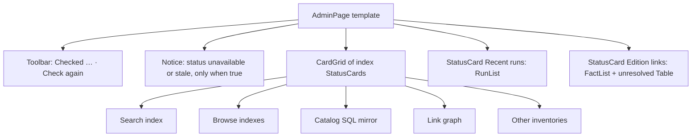

# Design sheet: Admin › Indexes

Route `#admin/indexes`. Source: `web/src/admin/pages/indexes.tsx`; the index catalogue (titles, facts, actions) lives in `web/src/backstage.tsx`.

## Focused activity

**Find the index that drifted and rebuild just that one.** Every index is a rebuildable copy of what the vault holds. The page answers these questions:

1. When were these last checked? Check again if that was too long ago.
2. Which index is not *Current*, and why (its message)?
3. What will a rebuild touch (its note), and which action do I want (with embeddings, or keywords only)?
4. Did my run (or a run another surface started) succeed, and what did it change?

Opening the page runs the light freshness check once if the last check is more than two minutes old. It never rebuilds on its own.

## Layout

Cards are in a grid that is one column on a phone and as many 20rem columns as fit above that. Each card keeps its actions in its footer, so the eye finds every Rebuild button in the same place.

## Atomic composition

| Tier | Parts |
| --- | --- |
| Atoms (shadcn) | `Button`, `ButtonGroup`, `Badge`, `Spinner`, `Table` |
| Atoms (theme) | `StatusBadge` (index state tones: Current = ok, Needs rebuild / Partial / Not built / Near = attention, Error / Over = error), `RelativeTime`, `Elapsed` |
| Molecules | `Toolbar`, `FactList`, `Notice` (retired-index removal, status errors; an index note is a muted line), `RunRow`, `LoadingState`, `Unavailable` |
| Organisms | `StatusCard` per index; `RunList` of recent runs; edition-links `StatusCard` with `Table` |
| Template | `AdminPage`, `CardGrid` |
| Page | `IndexesPage` binds `context.maintenance`, `startJob`, `checkIndexes`, `api` |

## States

| State | What shows |
| --- | --- |
| Loading | Badges read *Loading…*; Recent runs shows `LoadingState` |
| Status unreadable | `Unavailable` at the top; every card's badge reads *Unavailable*; actions are disabled |
| Last refresh failed | an info `Notice` saying the cards show the earlier status |
| Checking or rebuilding | toolbar Spinner *Checking…*; the active card's badge *Rebuilding…* with Spinner and an elapsed counter; all actions disabled |
| Static demo | toolbar says checks need Reader on your computer; actions are disabled by `localOnly()` |
| Retired format-1 index present | a `Notice` on the Search card with a *Remove* action |

## Theme and tokens

The page uses semantic utilities only. Tones choose a Badge variant; there are no custom colours.

## Test hooks

`#maintenance-check`, `#indexes-unavailable`, `#indexes-stale`, `[data-index=<key>][data-state]`, `[data-job=<kind>]`, `[data-fact=<label>] [data-fact-value]`, `#recent-runs [data-run-list] [data-job-state]`, `#edition-links[data-state]`, `[data-toolbar]`.
