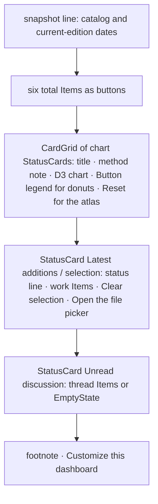

# Design sheet: Admin › Library

Route `#admin/library`. Sources: `web/src/admin/pages/library.tsx` (the page), `web/src/admin/pages/library-charts.ts` (the D3 drawing) and `libraryModel` in `src/reader_mcp/web_ui/dashboard.mjs` (every count, chart row and label, as plain data).

## Focused activity

**See what the library holds and what you have read, then open the works behind any number.** Selecting a total, a slice, a bar, a legend entry or an atlas topic lists its works, newest first, under *Latest additions*. Selecting it again (or *Clear selection*) returns to the latest additions. A work opens on click; Shift-click opens it in a split.

## Layout

Totals are two columns on a phone, three on a tablet and six on a wide screen. Chart cards follow the `CardGrid`. A donut sits beside its legend from `sm` up, and above it, capped and centred, on a phone.

## Atomic composition

| Tier | Parts |
| --- | --- |
| Atoms (shadcn) | `Button` (legend entries with `aria-pressed`, Reset, Clear selection, links), `Separator` |
| Molecules | shadcn `Item` (totals, works, threads), `Notice`, `EmptyState` |
| Organisms | `StatusCard` per chart, for Latest additions and for Unread discussion |
| Template | `AdminPage`, `CardGrid` |
| Page | `LibraryPage`, given `context.library` (the model and the app's open, picker, settings and tooltip actions) by `web_ui/app.mjs` |

Charts stay D3 drawings: each mark is a keyboard-focusable button (or link, in the atlas) that reports its choice to the page. Their SVG classes (`axis-text`, `chart-grid`, `bar-value`, `donut-total`, `donut-caption`, `topic-circle`, `work-dot`) are content styles. `chart-mount` and `data-chart-swatch` are the hooks that the high-contrast theme rules outline.

`app.mjs` caches the model per data and preferences object. Admin re-renders on every status poll, and a fresh model would redraw the charts and drop a selection.

## Test hooks

`#backstage-library`, `[data-library]`, `[data-statistics-grid]`, `[data-stat-panel=<id>]` (`#panel-<id>`, chart in `#chart-<id>`), `[data-chart-choice=<id>:<key>][aria-pressed]`, `[data-total=<n>] [data-total-value]`, `#editions-title`, `#dashboard-selection`, `#dashboard-reset`, `#latest-list [data-path]`, `[data-margin-item] [data-quote]`, `[data-count]`, `#atlas-reset`, `#all-works`, `#personalize`.
