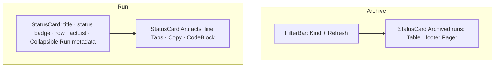

# Design sheet: Admin › LLM logs

Routes `#admin/logs` (the archive) and `#admin/logs/<kind>/<YYYY-MM-DD>/<run-id>` (one run). Source: `web/src/admin/pages/logs.tsx`.

## Focused activity

**Find a past model or agent run and read exactly what went in and came out.** The archive under `logs/llm/` is kept forever. These pages read it in bounded pages and previews and never prune it. The list answers *which run?* (filtered by kind, newest first). The run page answers *what happened?* (pinning facts, raw metadata on request, then each artifact).

## Layout

## Atomic composition

| Tier | Parts |
| --- | --- |
| Atoms (shadcn) | `Button`, `Select`, `Table`, `Tabs`, `Collapsible`, `CodeBlock` |
| Atoms (theme) | `StatusBadge` (open = active, failed = error, sealed = neutral) |
| Molecules | `FilterSelect`, `FilterBar`, `Pager`, `FactList` (rows), `LoadingState`, `EmptyState`, `Unavailable` |
| Organisms | `StatusCard` |
| Template | `AdminPage` |
| Pages | `LogsPage`, `LogPage` |

## States

These cover the static demo, an unreadable archive or run (a destructive Alert), an empty archive (`EmptyState`), no runs of the chosen kind (a muted table row), an open run (badge *· open*, with a description of `.partial` artifacts), a truncated preview (it says so; Copy copies the preview), and an artifact missing from the archive.

## Test hooks

`[data-admin-panel=logs|log]`, `[data-log-row=<run-id>]`, `[data-filter=logs-kind]`, `[data-pager]`, the artifact tabs (`role=tab`).
