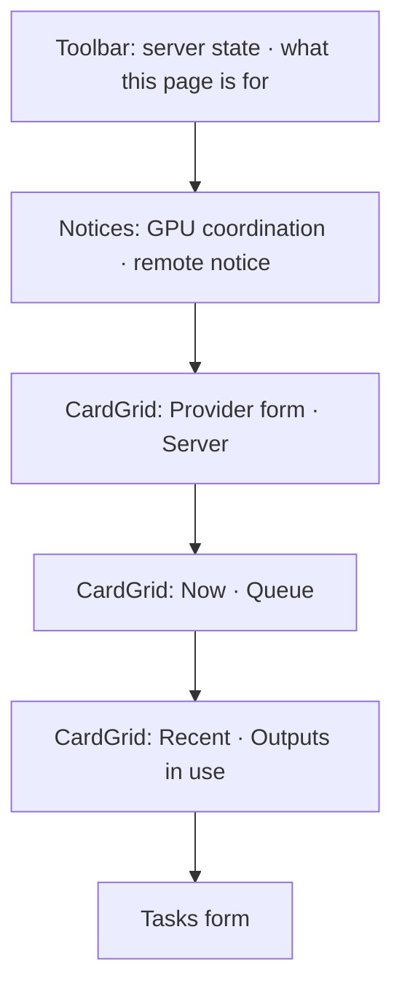

# Design sheet: Admin › Models

Route `#admin/models`. Source: `web/src/local-model.tsx` (`LocalModelSection` and its cards).

## Focused activity

**Run bulk, private, judgment-light language work on a model you control, and see what it produced.** The page answers these questions, top to bottom:

1. Which server am I talking to, and does my text leave this machine? (Provider)
2. Is the server up, and which models are loaded? (Server)
3. What is running right now, and how fast? (Now)
4. What is waiting, and how do I run, pause or queue more? (Queue)
5. What finished, and why was anything rejected? (Recent)
6. Which outputs are current or stale? (Outputs in use)
7. Which tasks may run, on which model? (Tasks)

Nothing runs until you press Run. A remote server is refused unless you allow it, and the page says plainly that text then leaves the machine.

## Layout

Two cards share each row on a wide screen and stack on tablets and phones. Forms keep their Save button in the card footer.

## Atomic composition

| Tier | Parts |
| --- | --- |
| Atoms (shadcn) | `Button`, `ButtonGroup`, `Switch`, `Select`, `Input`, `Spinner`, `Collapsible`, `AlertDialog` |
| Atoms (theme) | `StatusBadge` (server: Ready = ok, Busy and Starting = active, Off = neutral, Not installed = attention, Error = error; provider scope), `RunStateIcon` (recent outcomes; replaces the ✓ ! ✕ – glyphs) |
| Molecules | `Toolbar`, `Notice`, `FactList`, `LoadingState`; shadcn `Item` rows for models, queue tasks and recent items; `Field`/`FieldGroup` forms |
| Organisms | `StatusCard` ×7, `ConfirmAction` (*Stop server…* → *Stop for every tool* / *Keep running*) |
| Template | `AdminPage`, `CardGrid` |
| Page | `LocalModelSection` binds `context.localModel` and `localModelAction` |

The machine-written text styles stay as content styles, not components: `.lm-mark` (also used by the magazine), the live `.lm-preview` with its caret, and the `.lm-output` quote.

## Test hooks

`[data-lm=server|provider|now|queue|recent|outputs|settings|models|items|item-trigger|reason|count|sample|output|mark|thinking|remote-refused|remote-warning]`, `[data-server-state]`, `[data-provider]`, `[data-model][data-loaded]`, `[data-queue]`, `[data-item][data-item-state]`, `[data-outputs]`, `[data-setting]`, and the ids `lm-server-start`, `lm-server-stop`, `lm-server-stop-confirm`, `lm-server-state`, `lm-provider-*`, `lm-api-key*`, `lm-preview`, `lm-pause`, `lm-cancel`, `lm-gpu`, `lm-remote-notice`, `lm-remote-warning`.
