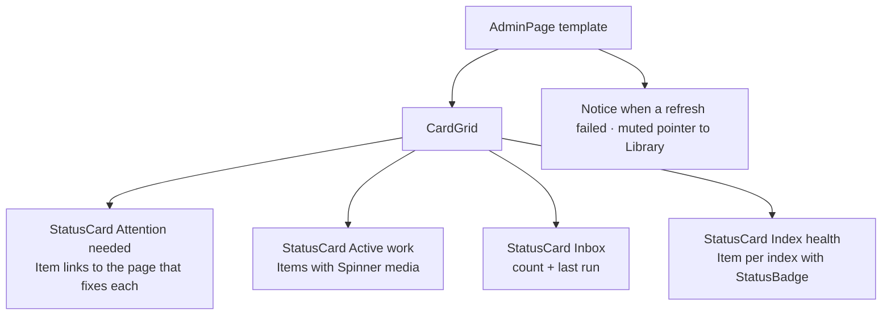

# Design sheet: Admin › Overview

Route `#admin` (and `#admin/overview`, `:backstage`, the footer's *Backstage*). Source: `web/src/admin/overview.tsx`.

## Focused activity

**Triage in one look: is anything running, waiting or broken, and where do I go about it?** The Overview is read-only. Opening it starts no check, rebuild, model or inbox run. Every tile ends in a link to the page where you would act.

The page answers these questions in reading order:

1. Does anything need my attention? (failed runs, drifted or over-limit indexes, a blocked inbox, unreadable status)
2. What is running right now? (maintenance jobs, the local model, the librarian, coding jobs)
3. Is mail waiting?
4. Are the indexes healthy?

## Layout

Attention comes first because it is the reason to open the page. Each tile's footer holds one ghost `Button` link (*Open the inbox →*). Primary actions are never placed on the Overview.

## Atomic composition

| Tier | Parts |
| --- | --- |
| Atoms (shadcn) | `Button` (ghost, rendered as a link), `Spinner`, `Badge` |
| Atoms (theme) | `StatusBadge`, `RelativeTime` |
| Molecules | shadcn `Item` rows (active work, attention links, index health), `LoadingState`, `Unavailable`, `Notice`, `EmptyState`-style quiet lines for *Nothing is running* and *Nothing needs attention* |
| Organisms | `StatusCard` tile ×4 |
| Template | `AdminPage`, `CardGrid` |
| Page | `Overview` binds `context.maintenance`, `context.inbox`, and the coding-jobs poll |

## States

Each tile is `loading`, `unavailable` (a destructive Alert with the reason) or `ready`. A status that could not be read is never shown as zero or as healthy. *Nothing is running* and *Nothing needs attention* appear only when every source has answered.

## Test hooks

`#admin-overview`, `[data-overview=active|inbox|attention|indexes][data-state]`, `[data-arrivals]`, `[data-check=<key>][data-state]`, `[data-unchecked]`, `[data-unavailable]`, `#admin-stale`.
