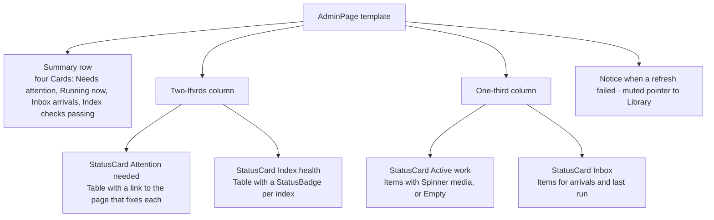

# Design sheet: Admin › Overview

Route `#admin` (and `#admin/overview`, `:backstage`, the footer's *Backstage*). Source: `web/src/admin/overview.tsx`.

## Focused activity

**Triage in one look: is anything running, waiting or broken, and where do I go about it?** The Overview is read-only. Opening it starts no check, rebuild, model or inbox run. Every tile ends in a link to the page where you would act.

The page answers these questions in reading order:

1. Does anything need my attention? (failed runs, drifted or over-limit indexes, a blocked inbox, unreadable status)
2. What is running right now? (maintenance jobs, the local model, the librarian, coding jobs)
3. Is mail waiting?
4. Are the indexes healthy?

## Layout

The summary answers "is anything wrong?" at a glance, and attention comes first below it because it is the reason to open the page. Below `xl` the columns stack; on phones attention details move under each item so Status and Open stay on screen. Index health, Active work and Inbox each offer one link to their owning page. Primary actions are never placed on the Overview.

## Atomic composition

| Tier | Parts |
| --- | --- |
| Atoms (shadcn) | `Button` (ghost or outline, rendered as a link), `Spinner`, `Badge`, `Skeleton` |
| Atoms (theme) | `StatusBadge`, `RelativeTime` |
| Molecules | shadcn `Item` rows (active work, inbox), `Table` rows (attention, index health), `LoadingState`, `Unavailable`, `Notice`, `EmptyState` for *Nothing is running*, a quiet line for *Nothing needs attention* |
| Organisms | `Card` summary ×4, `StatusCard` tile ×4 |
| Template | `AdminPage` |
| Page | `Overview` binds `context.maintenance`, `context.inbox`, and the coding-jobs poll |

## States

Each tile is `loading`, `unavailable` (a destructive Alert with the reason) or `ready`. A summary card shows a Skeleton while reading and a dash with the reason when its status could not be read. A status that could not be read is never shown as zero or as healthy. *Nothing is running* and *Nothing needs attention* appear only when every source has answered.

## Test hooks

`#admin-overview`, `[data-overview-summary=attention|running|inbox|indexes]`, `[data-overview=active|inbox|attention|indexes][data-state]`, `[data-attention=<key>]`, `[data-attention-subject]`, `[data-arrivals]`, `[data-check=<key>][data-state]`, `[data-unchecked]`, `[data-unavailable]`, `#admin-stale`.
