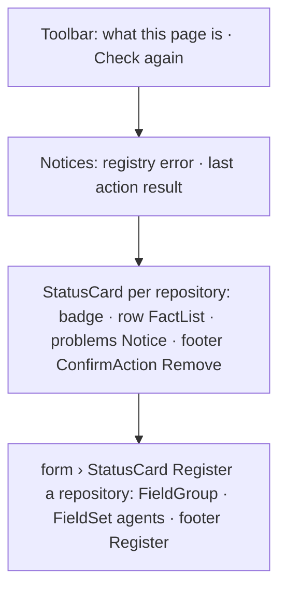

# Design sheet: Admin › Repositories

Route `#admin/repositories`. Source: `web/src/admin/pages/repositories.tsx`.

## Focused activity

**Decide which local checkouts article prompts may run in, and confirm each one is ready.** An article names only a GitHub repository. This page maps that name to a checkout, a remote and base branch, a worktree folder, the coding agents allowed to run, and the guarded command that must pass before a pull request opens. It stores no credentials.

The page answers these questions in order:

1. Is each registered repository *Ready*, and if not, what is wrong (its problems list)?
2. How do I register another one? (a form with server-side checks)
3. How do I stop using one? (*Remove*, confirmed in an AlertDialog that says the checkout, worktrees and branches are not touched)

## Layout

Paired fields (remote and base branch, store and keys) sit side by side from the `sm` breakpoint up and stack on a phone.

## Atomic composition

| Tier | Parts |
| --- | --- |
| Atoms (shadcn) | `Button`, `Input`, `Textarea`, `Checkbox`, `Spinner`, `AlertDialog` |
| Atoms (theme) | `StatusBadge` (Ready = ok, Needs attention = error) |
| Molecules | `Toolbar`, `Notice`, `FactList` (rows), `LoadingState`, `EmptyState`, `Unavailable`; shadcn `Field`, `FieldGroup`, `FieldSet`, `FieldLegend`, `FieldLabel`, `FieldDescription` |
| Organisms | `StatusCard`, `ConfirmAction` (replaces `window.confirm`) |
| Template | `AdminPage`, `CardGrid` |
| Page | `RepositoriesPage` |

## Test hooks

`[data-admin-panel=repositories]`, `[data-repository=<owner/name>]`, the Remove button and its `alertdialog` confirmation, `[data-repository-message]`, `[data-register-repository]`, and the field ids `repo-name`, `repo-checkout`, `repo-remote`, `repo-base`, `repo-worktrees`, `repo-agent-codex`, `repo-agent-claude`, `repo-verify`, `repo-timeout`, `repo-store`, `repo-keys`.
