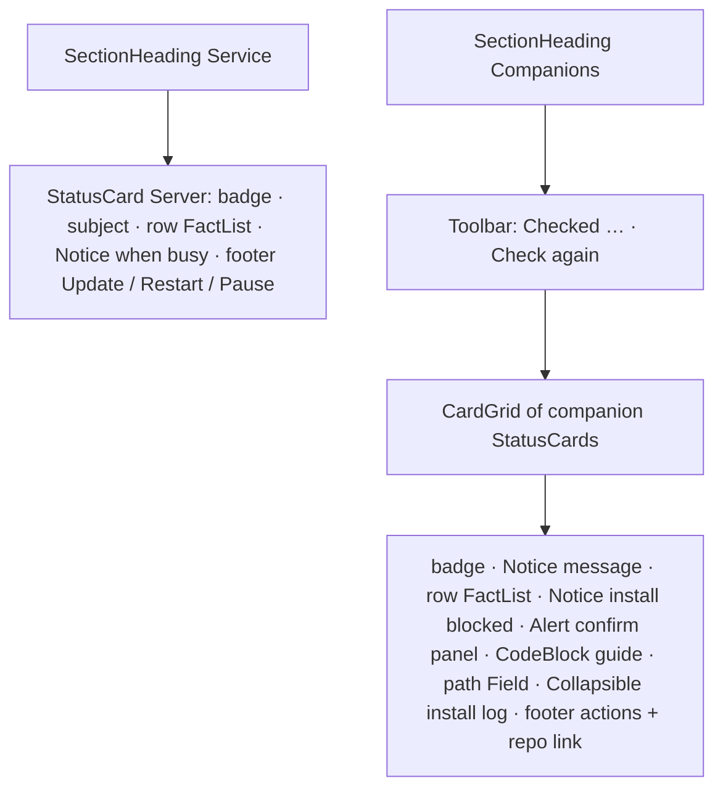

# Design sheet: Admin › Service & tools

Route `#admin/service`. Sources: `web/src/server-card.tsx` (Service) and `web/src/companions.tsx` (Companions). The companion prompt toast in the same file is reading UI and is out of scope.

## Focused activity

**Keep Reader itself healthy and add the optional tools that light up features.** The page has two groups.

- **Service:** is the always-on Reader running, on which commit, when does it next check for an update, and where is it reachable? From here you can update now, restart, or pause updates.
- **Companions:** for each optional tool (AI-TTS, Colorful Language, wide-md, git-locks), is it installed, what does it enable, and how do I install it, point Reader at it, or read its install log? An install lists what will change before anything runs.

## Layout

## Atomic composition

| Tier | Parts |
| --- | --- |
| Atoms (shadcn) | `Button`, `ButtonGroup`, `Kbd` (feature keys), `Input`, `Spinner`, `Collapsible`, `CodeBlock` |
| Atoms (theme) | `StatusBadge` (Running / Installed = ok, Updates paused / Too old / Not running = attention, Not found = neutral, Stopped / Error = error), `RelativeTime`, `SectionHeading` |
| Molecules | `Toolbar`, `Notice`, `FactList` (rows), `LoadingState`, `Unavailable`; shadcn `Alert` for the install confirmation; `Field` for the path form |
| Organisms | `StatusCard` (server and each companion) |
| Template | `AdminPage`, `CardGrid` |
| Page | `ServicePanel` binds `api`, `companions`, `companionAction` |

## Test hooks

`[data-card=service][data-installed]`, `[data-fact=commit|source|last-update|next-check|tailscale|identity|subject]`, `[data-fact-value]`, `#service-update|restart|pause`, `[data-companion=<name>][data-state]`, `[data-companion-badge]`, `[data-action=install|update|start|guide|set-path|check]`, `[data-companion-panel=confirm|guide|path]`, `[data-confirm]`, `#companion-guide-<name>`, `[data-companion-log]`, `#companions-check`.
