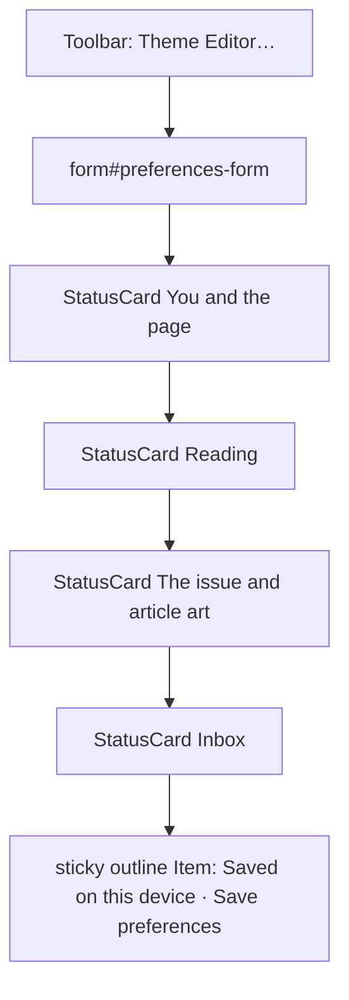

# Design sheet: Admin › Settings

Route `#admin/settings` (also `Space p`, `:set`, `:settings`). Sources: `SettingsPanel` in `web/src/admin/panels.tsx` and `SettingsForm` in `web/src/reader-controls.tsx`.

## Focused activity

**Change how Reader reads for you on this device, then save.** The preferences used to be one long list. They are now grouped by the question each answers:

1. **You and the page:** who is reading here (for read receipts) and the palette.
2. **Reading:** layout, page turn, pace, recent files, prose colors and the switches for what appears around an article.
3. **The issue and article art:** what the homepage issue leaves out, whether and how art is made, and by which producer.
4. **Inbox:** the permissions a You got mail run has.

The Theme Editor (colours, fonts, contrast checks) opens from the toolbar above the form.

## Layout

Each card's `FieldGroup` is capped at `max-w-2xl`, so fields stay readable on wide screens. The save bar sticks above the status line, so you can save from anywhere in the form.

## Atomic composition

| Tier | Parts |
| --- | --- |
| Atoms (shadcn) | `Input`, `Select` (through `Choice`), `Switch`, `Kbd` (replaces raw `<kbd>`), `Button`, `Spinner` |
| Molecules | `Field`, `FieldLabel`, `FieldDescription`, `FieldGroup`, `FieldSeparator`; `Toolbar`; the outline `Item` save bar |
| Organisms | `StatusCard` ×4 |
| Template | `AdminPage` |
| Page | `SettingsPanel` binds `context.settings` and `themeEditor` |

## Out of scope

The Theme Editor dialog (`web/src/theme/theme-editor.tsx`) keeps its own preview and token-swatch styles. Rebuilding that tool on shadcn primitives is follow-up work.

## Test hooks

`#backstage-settings`, `#preferences-form` (its `button[type=submit]`), `#theme-editor-open`, and the field ids (`profile-name`, `theme-choice`, `recent-count`, `reading-mode`, `page-turn`, `inbox-sandbox`, `prose-colors`, `reading-speed`, `issue-exclude`, `setting-*`, `art-by`, `art-auto`).
