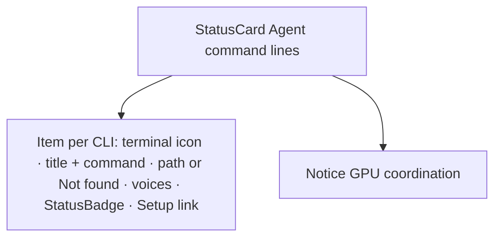

# Design sheet: Admin › Voices

Route `#admin/voices`. Source: `web/src/admin/pages/voices.tsx`.

## Focused activity

**Check that the command lines behind chat voices and the librarian are present on this computer.** Each agent CLI (Claude Code, Codex, Agy) runs with your own account, so Reader only finds it. It never installs one or signs in. The page answers two questions: which CLIs are present (and which voices use each), and what the GPU coordination for the local model is.

There is intentionally no install button. A missing CLI shows a *Setup* link to its own instructions.

## Layout

## Atomic composition

| Tier | Parts |
| --- | --- |
| Atoms (shadcn) | `Badge`, `Separator` (through `ItemSeparator`) |
| Atoms (theme) | `StatusBadge` (Found = ok, Not found = neutral) |
| Molecules | shadcn `Item`, `Notice`, `LoadingState`, `EmptyState`, `Unavailable` |
| Organisms | `StatusCard` |
| Template | `AdminPage` |
| Page | `VoicesPage` binds `context.companions` |

## States

Loading (`#companion-cli-pending[data-state=loading]`), unreadable (destructive Alert), none reported (`EmptyState #companion-cli-none`), and the list. The static demo shows the shell's *needs Reader* page.

## Test hooks

`#companion-cli`, `[data-cli=<name>][data-state]`, `#companion-gpu[data-gpu]`, `#companion-cli-pending`, `#companion-cli-none`. There are no `button` elements in `#companion-cli`.
