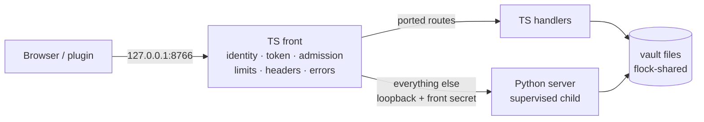
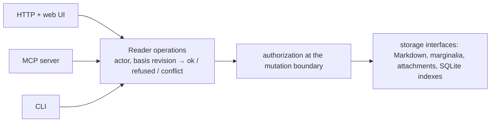

# Porting the Reader server to TypeScript: phase 0 and the plan

Status: the D1 plan, revision 2, with the user's rulings of 2026-10-27 (see [Decisions](#decisions)). Written
with the phase 0 foundation (`docs/port/surface.md`, `tests/contract/`, `scripts/port_bench.mjs`). Nothing here
ports production code. Measurements were taken on one Apple-silicon
Mac (18 cores, 64 GiB) on 2026-10-26; they are indicative, not a benchmark suite.

## Recommendations in one screen

1. **Runtime: Node.js 26 as the target,** with Node 24 LTS kept working if the lock adapter allows; check
   Node 26's LTS status at cutover. Type-check TypeScript in CI and publish compiled JavaScript: Node refuses to
   strip types inside `node_modules` (`ERR_UNSUPPORTED_NODE_MODULES_TYPE_STRIPPING`), so an npm package cannot
   ship `.ts` sources. Use `node:http` with no framework, `node:sqlite` with no native addon, and the official MCP
   TypeScript SDK. Bun measured about the same; keep Bun- and Node-only APIs inside one small `platform` module,
   so a Bun single binary stays possible later.
2. **One operations layer.** Ingesting, annotating, proposing and recording a reading each get one
   implementation that takes an actor and a basis revision and returns ok, refused or conflict. HTTP, MCP and
   the CLI are thin adapters over it, so each route PR ports its operation once.
3. **Rust: none in the core.** The measured hotspots are Python interpreter loops and pure-Python YAML. V8 handles
   both, so none of them needs native code. Colorful and wide-md stay Rust companions; their WASM builds are
   gated independently (Colorful first) and neither blocks removing Python.
4. **Migration: a strangler front.** A TypeScript server owns the port and every request check. It serves
   the routes ported so far and proxies the rest to the Python server, which runs as its supervised child on a
   private loopback port. Every merged step leaves `main` working, and the contract suite gates each step by
   passing unchanged against the front.
5. **Order:** the package skeleton and lock interop, then the front and checks, then the shared stores, works, links, versions and search reads, then the
   process supervisor, which also resolves #16 in TypeScript. Host integrations, chat, the inbox runner, art,
   MCP and CLI adapters follow, and removing the Python child comes last. The plan lists 22 atomic PRs (0, 1, 1b
   and 2 to 20, then 21).
6. **Storage stays Markdown plus SQLite,** with marginalia in today's JSON-and-lock store, through and after the
   port. No storage move is planned; a corrected git-warp spike (S1b) is running, see
   [Storage after the port](#storage-after-the-port).
7. **Install:** Reader installs through `npx`, an npm global install or a Homebrew formula that depends on
   `node`; CI installs the packed tarball outside the checkout. Correctness and a reliable install beat having
   zero native npm dependencies. A single-file binary built with `node --build-sea` can come later. Bringing
   your own AI stays as it is: agent CLIs, LM Studio, Ollama or llama.cpp.
8. **Stays Python, temporarily:** the keyword/embedding index worker, which the TypeScript side keeps calling as a
   subprocess until its own indexer lands. Also the contract fixture generator, and pytest suites for modules
   not yet ported. **Ported:** the inbox runner, the voice runner (with chat) and `reader_service.py`.

## What phase 0 delivered

| Piece | Where | What it gives the port |
| - | - | - |
| Surface inventory | `docs/port/surface.md`, generated by `scripts/port_inventory.py` (`--check` detects staleness) | Every route, POST action, request check, MCP tool, CLI flag, vault file (static literals plus an empirical scan), SQLite schema, lock, subprocess, network endpoint, environment variable, dependency and module size, plus contract coverage. Re-run it after main moves and diff the output |
| Contract suite | `tests/contract/` (`npm run test:contract`) | A language-neutral gate. It starts the server under test from `READER_SERVER_CMD`, the CLI from `READER_CLI_CMD` and MCP from `READER_MCP_CMD` (the defaults are this checkout's Python), and inspects only HTTP, stdio and vault files |
| Bench | `scripts/port_bench.mjs` | Times heavy routes on a large synthetic vault against any implementation, so the TypeScript and Python servers can be compared on equal terms |

### Contract suite at a glance

- **Scale:** 139 tests in 8 files. The whole suite runs in about 17.5 s, mostly the 15 s chat heartbeat wait, which
  runs in parallel with the other files; without it the suite takes about 7 s, and the CLI file, which runs `index` and
  `demo`, is the longest. Each file builds its own synthetic
  vault in about 1 s.
- **Fixture:** the public-domain demo vault, pinned to Wednesday 2026-10-21 12:00 UTC by
  `tests/contract/fixtures/build_vault.py`. The server under test runs with `READER_TEST_CLOCK` at the same
  instant, a scrubbed environment (temporary `HOME`, minimal `PATH`), dead model and speech endpoints and
  git-locks off. The fixture builder is the suite's only Python touchpoint and is replaceable through
  `READER_FIXTURE_CMD`. Once `demo` is ported, it can take `--today`.
- **Golden shapes:** JSON-schema-like snapshots in `tests/contract/golden/`, recorded from Python. They keep types,
  string formats (datetime, date, sha256, uuid, sha1), optional keys and maps keyed by data. They never keep
  values, so timestamps, ids and ordering are normalized away. Record new ones with `READER_CONTRACT_UPDATE=1`
  against the reference server, and review each diff.
- **Coverage:** all 70 method+path routes (51 GET, 19 POST), all 16 CLI subcommands, all 13 MCP tools listed
  with their input schemas, and 6 of those tools called. 23 of 44 named POST actions are exercised; `surface.md`
  lists the rest. Every stored format has a check: exact SQLite schemas for `search.v2`, `links`, `catalog` and
  `embedding-cache`, plus shapes of every JSON store. Two cross-process rules are covered: flock-serialized
  writers, and one chat owner per vault (#20, #72).
- **What it does not pin yet:** values and ranking, such as search order and fuzzy scores, and successful runs of
  host integrations (speech, Colorful, inbox runs, service actions, companion installs, local-model server
  control). For those it checks only validation and refusal. Each port PR below adds value-level tests for what it
  moves, recorded from Python before the move.

### Measured hotspots in the Python server

Synthetic vault: the demo plus N generated Markdown works of about 4 KiB each, with headings and cross-links.
Medians of warm HTTP requests come from `node scripts/port_bench.mjs --works N` with the Python server.

| Route or step | 2,032 works | 6,032 works | Note |
| - | - | - | - |
| `reader index --no-semantic` | 2.2 s | 5.3 s | about 70% is YAML frontmatter parsed twice by pure-Python PyYAML (#163) |
| `reader browse` | 0.5 s | 1.5 s | refuses at about 2,000 works of 16 KiB or more (#161) |
| server start to first URL | 133 ms | 133 ms | importing `reader_mcp.web` alone takes 140 ms (numpy, rapidfuzz, pydantic) |
| `GET /api/search/page` (best/words) | 113 ms | 150 ms | 0.45 s per call under cProfile: `search.readable`/`fold` loop over each character of 498 passages |
| `GET /api/search` keyword | 24 ms | 78 ms | the Python loop in `Search.search` over FTS rows; SQLite itself takes 1.3 ms |
| `GET /api/library` | 10 ms | 28 ms | 0.9 MB and 2.6 MB of JSON: building the rows, then encoding them (6 ms for 2.6 MB) |
| `GET /api/search` fuzzy | 7 ms | 20 ms | rapidfuzz (C++) |
| everything else measured | under 6 ms | under 16 ms | link counts, next, queue, history, issue, shape (warm), readers (warm) |

Runtime microbenchmarks on the same 6,032-work index (`search.v2.sqlite3`, 6,714 passages):

| Operation | Python 3.14 | Node 26 | Bun 1.4 |
| - | - | - | - |
| FTS5 `MATCH` + `bm25` top 200 | 1.32 ms | 1.49 ms | 1.85 ms |
| FTS join to passages and chunks (500 rows) | 0.21 ms | 0.24 ms | 0.22 ms |
| `docs` table scan (6k rows) | 1.75 ms | 1.79 ms | 0.76 ms |
| parse 2.6 MB library JSON | 6.5 ms | 2.7 ms | 2.5 ms |
| serialize it | 6.4 ms | 1.1 ms | 0.9 ms |
| Unicode fold of 500 passages (NFD, strip marks, lower) | 12.7 ms | 1.3 ms | 1.3 ms |
| bare startup | 10 ms | 70 ms | under 10 ms |
| SSE: 20,000 events to a client | — | 15 ms | 19 ms (`Bun.serve`) |
| noticing a closed SSE client | polled every 250 ms (#152) | 1.0 ms (`close` event) | 0.5 ms |

What this means:

- SQLite costs the same from every runtime, because all three use the same C library. Node's built-in SQLite
  3.53.4 has FTS5 enabled.
- The slow paths are interpreter work, which V8 does 5 to 10 times faster.
- At 6,000 works no route the web UI uses exceeds 150 ms, so the port is not a performance rescue. The case for
  it rests on install, maintenance and one language across UI and server.
- Not measured: semantic embedding. The model is not on this machine and the bench stays offline. Embedding cost
  is ONNX runtime and tokenizer work (C++ and Rust under fastembed), not Python, so it moves with whatever binary
  provides it.

## Runtime: Node, with Bun kept possible

| | Node 26 | Bun 1.4 | Deno |
| - | - | - | - |
| TypeScript without a build | in the checkout only (type stripping is refused inside `node_modules`, so the package ships compiled JS) | yes | yes |
| SQLite with FTS5, no addon | `node:sqlite` (3.53.4) | `bun:sqlite` | `node:sqlite` compat or an npm addon |
| flock for shared vault locks | behind a replaceable lock adapter: `node:ffi` (experimental and explicitly unsafe; verified to interoperate with a perl `flock` holder), else `lockf(1)` on macOS and `flock(1)` on Linux | `bun:ffi` (verified the same way) | FFI behind a permission flag |
| Single binary | `node --build-sea` | `bun build --compile` (mature) | `deno compile` |
| Ecosystem fit | Playwright, the web build, the Obsidian plugin and the test runner already use Node | runs Node code, with gaps | separate toolchain |
| Measured here | see above | see above | not installed, so not measured |

**Ruling: Node 26 as the target.** Contributors and users already have it and the repo's tooling already runs on
it. `node:sqlite` exists on Node 24, so keeping 24 LTS costs little apart from the lock; if `node:ffi` proves the
only sound `flock`, Node 26 becomes the floor and the reason is written down. Bun's edge is startup time and a mature single-binary compiler, and
neither matters for a long-running server. Keep Bun as a CI target only if the user wants a Bun binary; the
contract suite runs against either one unchanged.

## Libraries

| Need (Python today) | TypeScript choice | Notes |
| - | - | - |
| HTTP (`http.server`) | `node:http`, no framework | The router is about 70 routes with custom identity, admission and error mapping; a framework would add nothing and hide the checks |
| SQLite (`sqlite3`) | `node:sqlite` | Same schemas (pinned by `vault-files.test.mjs`); WAL is shared safely with Python during coexistence |
| MCP (`mcp` FastMCP) | `@modelcontextprotocol/sdk`, stdio transport | Register tools through the low-level `tools/list` handler with hand-written JSON Schemas. The goldens normalise only incidental differences and keep enums, bounds, unions, nullability, `additionalProperties` and refusal behaviour (decision 7) |
| YAML frontmatter (PyYAML, YAML 1.1) | `yaml` (eemeli), pure JS | Highest parity risk: YAML 1.1 versus 1.2 booleans, unquoted dates and duplicate keys. Needs a frontmatter parity corpus first (PR 6) |
| Validation (pydantic) | hand-written validators | The JSON contracts are small; zod only if it earns its keep |
| PDF text (pypdf) | `pdfjs-dist`, already vendored for the UI | Text and line coordinates will differ, so search coordinates change. The index is rebuildable, and annotations are Markdown-only |
| Fuzzy matching (rapidfuzz) | a small port of the scorers in use, or `fastest-levenshtein` | Ranking needs value-level tests before the move (PR 10) |
| Vectors (numpy) | `Float32Array` loops | Cosine similarity, float16 pack/unpack and a three-component SVD for shapes; under 200 lines |
| Images (Pillow) | header parsing for PNG/WebP dimensions | Parsing dimensions does not prove a still decodes; still-image validation (PR 18) needs value tests for undecodable files |
| Embeddings (fastembed) | the configured provider's OpenAI-compatible `/embeddings` (already a backend), with local LM Studio a first-class provider; the Rust `reader-embed` sidecar stays optional | Changing the model or its version changes search behaviour, so it rebuilds the index |
| git-stunts packages | plumbing, trailer-codec, alfred, bijou (CLI) | Each behind a narrow Reader interface. vault is held until its platform adapters and unattended-service behaviour are checked |
| Process limits (`resource.setrlimit`) | `/bin/sh -c 'ulimit -t … -f …; exec …'`, process groups through `detached`, RSS by `ps` | Node has no setrlimit; the shell wrapper is POSIX |

## Where Rust is worth it

- **Not:** search ranking, folding, YAML, JSON, link parsing or prose statistics. They are interpreter-bound in
  Python and fast in V8 (the measurements above). A napi module would also put native builds into every install
  for no measured gain.
- **Already Rust, as companions:** wide-md (reading copies) and Colorful Language (prose colouring) are external
  binaries today. Keep them that way. WASM builds are gated independently: Colorful first (spike S2a, for the
  browser and the static demo, with Chromium and WebKit parity, startup, memory and large-document checks),
  wide-md later when the packaging is worth it. Neither blocks removing Python.
- **Worth it, optionally:** `reader-embed`, a sidecar binary on fastembed-rs or ort with BAAI/bge-small-en-v1.5
  that speaks JSON lines over stdio. It keeps semantic search, related works and shapes offline and Python-free.
  Ship it as a companion (install, check, update) and not as a napi addon. Prove vector parity with the Python
  fastembed output on a fixed corpus before it replaces anything. Until then the TypeScript server can keep
  calling the Python index worker.
- **Fallback for flock:** if `node:ffi` stays experimental and `lockf`/`flock` wrapper processes prove too slow on
  hot write paths, a tiny static Rust `reader-lock` helper is the next step behind the same lock adapter.
  Measure first.

## Migration strategy: strangler front

- **Why a front rather than the alternatives:**
  - Putting Python in front and proxying ported routes to TypeScript keeps Python as the trunk to the last step,
    and leaves the identity code in the language being retired.
  - A big-bang rewrite breaks the rule that every merged PR leaves `main` working.
  - Running both servers side by side on different ports would split chat ownership and state (#20, #72).
- **How each step is gated:** every PR runs the whole contract suite with `READER_SERVER_CMD` set to the front,
  for example the built front's entry point, and with the default Python. Both must pass. A PR that moves routes first
  adds value-level tests recorded from Python, then moves the code. The coexistence tests (shared flock, a single
  chat owner) keep running throughout, because during migration the TypeScript handlers and the Python child
  write the same vault concurrently. The contract suite grows in this priority order: YAML interpretation,
  search ranking, annotation coordinates, process ownership, working host integrations, recovery. Mutation tests
  run against separate fixture copies, never a live vault.
- **Blocking work stays off the request thread:** `node:sqlite` is synchronous and WASM is no faster
  asynchronously, so heavy indexing and text analysis run in worker threads or child processes.
- **Stateful subsystems move whole:** chat (runner, supervisor lock, SSE), art (studio worker), local model (queue
  worker), maintenance jobs and inbox runs. A subsystem's routes never straddle the two processes.

## One operations layer

- **One implementation per operation:** ingest, annotate, propose a revision, record a reading and the rest.
  Every call names its actor and the document revision it was based on, and returns ok, refused or conflict.
- **Adapters stay thin:** HTTP routes, MCP tools and CLI commands parse, call the operation and map its result.
  Each route PR ports its operation once; PRs 19 and 20 are adapter work over operations already ported.
- **Authorization lives at the mutation boundary:** the operation checks that the actor may change the records it
  touches. Separate writer IDs or refs do not do this by themselves, and agents that edit vault files directly
  bypass it; the docs say so.
- **Packaging:** modules inside Reader; a separate package only when another app needs it.

## Annotation anchors during the port

- Annotations keep today's convention, **Unicode code-point offsets**. JavaScript strings are UTF-16 and Rust
  engines may report byte offsets, so every boundary converts explicitly.
- The contract suite gains anchor cases (PR 5): emoji, combining marks, repeated passages and transformed reading
  copies.
- Recording which revision and representation an annotation addresses, and whether reattachment was unique,
  ambiguous or failed, is a separate change after the port.

## The ordered PRs

Each row is one atomic PR. Prerequisites name only PRs that must be merged for this one to be correct. "Contract"
means the whole suite passes against both the front and Python, plus the tests named.

| # | Scope | Prerequisites (why) | Acceptance |
| - | - | - | - |
| 0 | **This PR:** inventory, contract suite, bench, plan | — | suite passes against Python; `port_inventory.py --check` clean |
| 1 | Python accepts a trusted front: with `READER_WEB_FRONT_SECRET` set, it takes requests only with that secret, takes identity from `X-Reader-Identity` and the write token from the front. Off by default | — | contract unchanged; new pytest: no secret means 403, and a tailnet identity survives the hop |
| 1b | TS package skeleton, packed install and lock interop: the TypeScript package, type-checked in CI and built to JavaScript; the replaceable lock adapter | — | the `npm pack` tarball installs and runs in a clean directory outside the checkout on Node 26 (and Node 24 if the adapter allows); Python↔TypeScript `flock` contention tests both ways; a crashed holder releases the lock |
| 2 | TS front, pass-through: `server/` binds the port, implements identity, token, admission pools, body limits, headers, error mapping and SSE pass-through; it supervises the Python child (start, restart, stop with it) | 1 (without the identity handoff, tailnet users would look local, and companion path-setting would open up), 1b (the front ships in that package and uses its lock adapter) | full contract against the front; front tests: a child crash gives 503 and then recovers, and a client hang-up frees the slot at once |
| 3 | Updater: the smoke step runs `tests/contract` read and security tests against the candidate's real entry point; `start_web.py --front` and `reader_service.py install --front` switch the LaunchAgent to the front (default off) | 2 (the front must exist to be smoked) | smoke passes in both modes; flipping the flag and kickstarting serves the same vault; rollback by flag |
| 4 | Port static files, `/api/health`, `/api/file`, themes and fonts | 2 | read/security/theme tests; ranges, CSP and sandbox headers |
| 5 | The operations layer and TS vault primitives (atomic replace with fsync and link-publish, symlink refusals, code-point offsets), plus the annotate, record-a-reading and bookmark operations with their stores: `POST /api/annotations`, `/api/seen`, `/api/bookmark`, `GET /api/discussion` | 2 | write tests; ok/refused/conflict cases with a stale basis; the flock coexistence test with a TS writer; the anchor cases (emoji, combining marks, repeated passages, transformed reading copies); conflict cases (two replacements of one comment, an edit racing a delete) surface a conflict |
| 6 | Works and documents: coverage and catalog reading, frontmatter (YAML parity corpus), `/api/library`, `/api/document`, `/api/preview`, `/api/readers`, `/api/standfirst`, `/api/issue`, `/api/editions*` | 5 (bootstrap and readers report receipts and threads) | read tests; a frontmatter parity corpus run through both implementations |
| 7 | Queue, history and next (related works without vectors): `/api/queue`, `/api/history`, `/api/next` | 6 (rows are built from works) | read/write queue tests; value tests for the suggestion order |
| 8 | Link graph: `links.sqlite3` read and refresh, `/api/links`, `/api/link-counts`, `/api/resolve*`, `/api/embeds` | 6 (resolution uses the works inventory) | read tests; the transclusion corpus `tests/fixtures/transclusion/corpus.json` |
| 9 | Versions and changes through `git cat-file --batch`: `/api/versions`, `/api/version`, `/api/changes` | 6 | read tests; value tests for diff hunks |
| 10 | Search, read side: keyword and fuzzy over `search.v2.sqlite3`, `/api/search`, `/api/search/page`; semantic queries through the configured provider (LM Studio included) or the Python index worker | 6 | read tests; new top-k ranking tests recorded from Python first |
| 11 | Shapes: `/api/shape` (term vectors, three-component SVD) | 10 | read test; value test on point counts and seeds |
| 12 | TS process supervisor: process groups, `ulimit` wrapper, RSS polling, deadlines, bounded logs. This is #16 done once, in TypeScript | 2 | unit tests (orphaned grandchildren killed, limits enforced); nothing routed yet |
| 13 | Host integrations, part 1: speech (AI-TTS socket), prose (Colorful), `/api/speak*`, `/api/prose` | 12 (Colorful runs under the supervisor) | refusal tests plus fake AI-TTS and fake Colorful success tests (the existing `tests/fake_*.py` servers, as external processes) |
| 14 | Host integrations, part 2: companions, maintenance jobs and the service bridge | 12 | write/read tests; fake companion installers |
| 15 | Local model: `/api/local-model`, queue worker, standfirst and keyterm caches | 12 | fake LM Studio and OpenAI-compatible servers (`tests/fake_lmstudio.py`, `tests/fake_openai_servers.py`) as external processes |
| 16 | Chat: registry, chats store, voice runner, voice tasks (quizzes, prompts), SSE; takes over `supervisor.lock` | 12 (turns run under the supervisor), 6 | chat-stream, heartbeat and ownership tests; fake voice CLIs; turn recovery after a restart |
| 17 | Inbox view and inbox runner (`reader inbox-run`, with `python -m reader_mcp.inbox_runner` kept as a shim for the Obsidian plugin for one release) | 12 | inbox tests with the fake Codex (`tests/fixtures/codex-exec-scripted.jsonl`) |
| 18 | Art studio and writing | 16 (art producers are voices), 12 | art and writing tests; still-image validation |
| 19 | MCP adapter in TS (`reader serve`) over the operations layer; the delivery (`ingest`, `status`) and curation operations, which no earlier PR owns, are ported here once | 5, 10 | mcp tests; MCP schema goldens with only incidental differences normalised (decision 7) |
| 20 | CLI adapter in TS: annotate, curation, queue, browse, catalog, metadata, reading-copy, search/read over the existing operations; `index` (a TS indexer off the request thread, embeddings by the configured provider or `reader-embed`; a model or version change rebuilds the index), `demo` with `--today` | 19, 10 | cli and vault-files tests against the TS CLI; the fixture builder switches to `reader demo --today` |
| 21 | Remove the Python child: the front becomes the server; packaging (compiled JS, npm `bin`, Homebrew); the LaunchAgent runs node directly; `reader service` ported | all of the above | contract suite with Python absent from `PATH`; the packed tarball installs on a clean machine; Node LTS status checked |

### Held items mapped onto the plan

| Item | Where it lands | Why there |
| - | - | - |
| RW-40 install, config and named vaults | after 20, built in TS on the new CLI; it is also where packaging (21) gets its config | install/config is CLI-heavy; doing it in Python first would be redone |
| #37 the updater syncs Python deps for the live worktree | PR 3 for the migration period (the Python child still needs its venv); it disappears at 21 (no Python venv) | the risk exists only while Python runs |
| #38 `restart --detach` and launchd teardown | PR 3, with the D13 maintenance-window test | launchd behaviour is language-neutral; PR 3 already touches the updater |
| RW-36 ask the library | after 10 and 15, in TS | it needs retrieval (search read side) and a model provider |
| RW-38 reading pack exporter (owns #112, flatten embeds) | after 8, in TS, built against the transclusion corpus | the flattener walks the `/api/embeds` tree that PR 8 ports |
| #16 runner supervision duplicated across runners | PR 12; close #16 when 16 and 17 adopt the TS supervisor | refactoring Python code that is about to be replaced is wasted work |
| RW-35 web clipper's server intake endpoint | after 19 (delivery in TS) | the browser-extension half can start any time |
| Echo/Amblicit assessment for bounded librarian proposals | after 5; no work before 7 | it would plug into the operations layer |
| Anchor redesign (revision, representation, reattachment outcome) | after 21 | it must not ride along with the port |

## Storage after the port

Markdown in the git tree and SQLite indexes (rebuildable, stamped with the source revisions they reflect) stay
throughout the port. Each item below is its own later decision:

- **git-warp fo- **git-warp for marginalia: undecided, pending S1b.** The first spike (S1, 2026-10-27) is withdrawn: its
  harness bypassed git-warp's documented application path (Wesley-generated intents and observers), imported
  internal modules, deleted git-warp's own checkpoint refs and stored membership as growing JSON strings
  instead of edges, so its numbers measured that mapping rather than git-warp. S1b reruns the same data and
  tests through the public surface only. There is no PR 22 unless S1b supports one.
re shown, whatever the store:** two replacements of one comment and an edit racing a delete
  must surface a conflict, never pick a winner silently. These are contract cases in PR 5.
- **Before any storage move,** specify a Reader checkpoint (documents' tree or commit, marginalia history
  coordinate or writer heads, attachment roots, schema and interpreter versions) and two artifacts, each with a
  restore test into a fresh environment: a **portable export** of current records (today's JSON) and a
  **complete recovery archive** that keeps causal history and receipts.
- **Version fencing:** Reader checks compatibility whenever it opens or syncs durable history and refuses
  unsupported versions with a clear message; a change in meaning needs an explicit, reviewed migration.
- **git-cas** is deferred behind an attachment interface until it delivers a concrete benefit.

## Packaging and install

The audience brings its own AI (agent CLIs, LM Studio, Ollama, llama.cpp), so the install has to be boring:

- **npm:** `npx reader-library demo`, or `npm install -g reader-library`, then `reader web`. The package is
  compiled JavaScript and needs Node (26, or 24 LTS if the lock adapter allows), with no Python or compiler. CI
  type-checks the sources and installs the packed tarball in a clean directory outside the checkout.
- **Homebrew:** a formula that depends on `node`. It installs the package and offers `reader service install`
  for the LaunchAgent.
- **Single binary, later:** `node --build-sea`, or a Bun compile, for people without Node, once the code has no
  dynamic imports that block it.
- **Companions stay optional and separate,** each with an install, check and update action: AI-TTS, Colorful,
  wide-md, git-locks, and `reader-embed` if it is ever scheduled.

## Switching over the live LaunchAgent and updater

1. **Today:** the web agent runs `python scripts/start_web.py --port 8766` in the live worktree. The updater runs
   `reader_service.py update` every 10 minutes and smoke-tests each candidate commit (`tests/test_web.py` plus a
   fixture server) before it advances. It rolls back to the previous commit when a commit is unhealthy.
2. **After PR 3:** the smoke step also runs the contract read and security files, about 3 s, against the
   candidate's configured entry point, so a front that breaks a route never goes live. The user flips
   `reader_service.py install --front`, then kickstarts, and the agent runs the front, which runs Python as its
   child. To roll back, flip the flag off. Both modes serve the same vault and port. Chat ownership never splits,
   because only the child (until PR 16) or the front (after) holds `supervisor.lock`.
3. **At PR 21:** the plist runs node directly. The updater must survive its own change of language. Ship
   `reader service` in TS one release earlier, while `reader_service.py` still works, and have the last Python
   updater run `reader service install`, which rewrites both plists. Keep the previous plist backup, as
   `install` already does.

## What stays Python, and for how long

| Part | Decision |
| - | - |
| pytest suites | stay until their module is deleted; they shrink with each port PR. The contract suite is the cross-language gate |
| Contract fixture generator | stays until PR 20 (`reader demo --today`) |
| Index worker (`READER_INDEX_WORKER=1 python -m reader_mcp.cli index`) | stays as a subprocess the TS server calls until PR 20 |
| Inbox runner | **port** (PR 17). It is small and stdlib-only, but keeping it would keep Python as an install requirement. Keep a module shim for the Obsidian plugin for one release |
| Voice runner | **port** with chat (PR 16). It lives inside the server process (threads, supervisor lock), so it cannot stay Python without keeping a Python server |
| `scripts/reader_service.py` | **port** as `reader service` before PR 21 (see above) |
| Skill scripts (`skills/*/scripts/*.py`) | stay Python, stdlib only. They call the `reader` CLI, so update their `.venv/bin/reader` paths to the `reader` binary at 21 |
| Install verifiers (`scripts/verify_*.py`) | replace with contract-style checks at 21 |

## Risks

1. **flock from Node.** `node:ffi` is experimental and explicitly unsafe in Node 26. The lock adapter keeps it
   replaceable by wrapper processes (`lockf(1)`, `flock(1)`) or a tiny Rust helper, and PR 1b proves contention
   and crash behaviour against Python before anything depends on it.
2. **YAML and metadata parity.** PyYAML implements YAML 1.1 (and turns `2026-10-21` into a `date`); JS libraries
   default to 1.2. A metadata contract break would show up as invalid or changed catalog entries. Build the parity
   corpus before PR 6.
3. **Shapes are not semantics.** The goldens pin structure, not values, ranking or ordering. Each move must add
   value tests first, or behavior drifts unseen (search order, fuzzy scores, suggestions).
4. **Code-point offsets.** Annotations use Unicode code-point offsets (Python string indexes), while JS strings
   are UTF-16. One missed conversion silently misplaces highlights on text with emoji; the PR 5 anchor cases
   guard it.
5. **Concurrent writers during migration.** Two implementations write the same files. The coexistence tests
   cover flock and chat ownership, but any new lock or cache file has to be shared the same way.
6. **PDF text extraction changes** search coordinates and spoken text (pypdf versus pdf.js). The index is
   rebuildable, but anyone who scripted against line numbers would notice.
7. **Size.** About 21,000 dense Python lines (`surface.md` has the table) become perhaps 15,000 to 20,000 lines of
   TypeScript, over roughly 22 PRs. Two implementations must be kept honest throughout, so keep Python-only
   feature work small until PR 16.
8. **MCP schema drift.** The input-schema goldens are FastMCP/pydantic-shaped. Agents that cached tool schemas
   could break on a careless change, which is why decision 7 keeps the goldens strict.
9. **A synchronous database on the request thread.** `node:sqlite` blocks the event loop; heavy indexing and
   analysis run off it, and the bench watches request latency during indexing.

## Decisions

Approved by the user on 2026-10-27:

1. **Runtime:** Node 26 as the target; TypeScript type-checked in CI and published as compiled JavaScript.
2. **The strangler front,** including PR 1's small Python change: a front secret and identity handoff, off by
   default.
3. **Embeddings:** the configured provider, with local LM Studio first-class; a model or version change rebuilds
   the index. `reader-embed` stays optional and unscheduled.
4. **Minimum Node version:** Node 24 LTS stays supported if the lock adapter allows; otherwise Node 26 is the
   floor, with the reason recorded. Node 26's LTS status is checked at cutover.
5. **One operations layer** that HTTP, MCP and the CLI adapt; PRs 19 and 20 are adapter work.
6. **Storage:** Markdown plus SQLite, and the JSON-and-lock marginalia store, through and after the port;
   git-warp undecided pending S1b (S1 withdrawn); git-cas deferred; the vault package held.
7. **MCP schemas:** normalise incidental differences only; keep enums, bounds, unions, nullability,
   `additionalProperties` and refusal behaviour.

Still open:

1. **Distribution:** the npm package name (`reader-library` matches the Python project name), a Homebrew tap, and
   whether a single binary matters for the first release.
2. **Compatibility window:** how long `python -m reader_mcp.inbox_runner` and `.venv/bin/reader` keep working as
   shims for the Obsidian plugin and skills (recommended: one release).

## Issues filed while inventorying

- #160: numpy is imported but undeclared; fonttools is declared but unused.
- #161: browse's 32 MiB metadata budget is reached by about 2,000 long documents, below the 10,000-work limit.
- #162: some calendar timestamps bypass `reader_mcp.clock` (chat creation, notebook dates, reading copies,
  maintenance and health times).
- #163: index parses frontmatter twice with the pure-Python YAML loader, which is most of keyword indexing time.
- #164: dispatchers leak Python `TypeError` messages in 400 responses.
