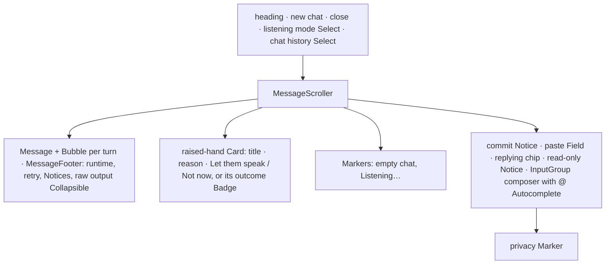

# Design sheet: Chat with the voices

The panel opens with `Space m` in any document. Sources: `web/src/chat/chat-panel.tsx` (the panel) and `web/src/chat/raw-output.tsx` (each turn's raw CLI output).

## Focused activity

**Ask the voices about this document and follow what each one did to answer.** Mention a voice with `@` or let one be chosen at random, then read the reply as it streams. When a voice raises a hand you choose whether it speaks. If something fails, read why, and open the raw output when you need to check a voice's work.

## Layout

## Atomic composition

| Tier | Parts |
| --- | --- |
| Atoms (shadcn) | `Button`, `Badge`, `Kbd`, `Select`, `ToggleGroup` (raw Steps / Events), `Collapsible`, `InputGroup` and `InputGroupTextarea`, Combobox/Autocomplete |
| Chat primitives (shadcn) | `MessageScroller`, `Message`, `MessageHeader`, `MessageFooter`, `Bubble`; `Marker` for system notes (empty chat, Listening…, privacy) |
| Molecules | `Badge` (a failed turn's state, listening warnings); muted `Item` (the Replying-to strip); `Notice` (turn errors with a stderr Collapsible, warnings, commit failure, read-only); the quote `Button` that jumps to the message replied to; raw step `Item`s with state Badges |
| Organisms | the raised-hand `Card` (`CardHeader`, `CardTitle`, `CardDescription`, `CardAction`, `CardFooter`); `RawOutput` |

## Test hooks

`#chat-panel`, `#chat-title`, `#chat-input`, `#chat-send`, `#chat-paste-toggle`, `#chat-paste-body`, `[data-chat-message][data-author][data-chat-state][data-chat-kind]`, `[data-chat-hand][data-hand-state]`, `[data-chat-hand-accept|decline|state]`, `[data-chat-quote]`, `[data-chat-reason]`, `[data-chat-warning]`, `[data-chat-failed]`, `[data-chat-facts]`, `[data-chat-runtime]`, `[data-chat-turn-state]`, `[data-chat-chimed]`, `[data-chat-elapsed]`, `[data-chat-empty]`, `[data-chat-privacy]`, `[data-raw-error]`, `[data-raw-events]`, `[data-chat-listening]`, `[data-chat-listened]`, `[data-chat-listen-raw]`, `[data-chat-raw][data-compact]`, `[data-raw-view]`, `[data-raw-kind][data-raw-state]`, `[data-raw-text]`, `[data-raw-note]`, `[data-chat-read-only]`, `[data-chat-replying]`. Collapsibles report open state as `data-open` on their root. Only two classes keep their own CSS: `.chat-panel` (the panel's position and dock) and `.chat-markdown` (rendered Markdown prose).
