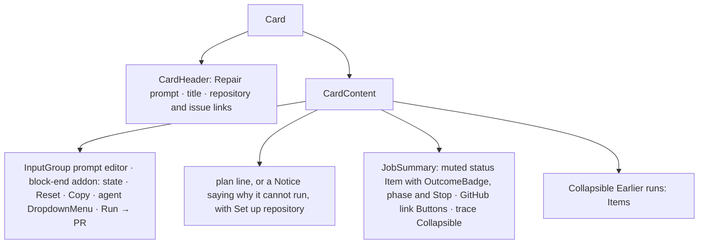

# Design sheet: Article prompt card

An article's `<!-- reader:prompt {…} -->` block renders as this card in the reading view. Sources: `web/src/jobs/prompt-card.tsx`, plus `JobSummary` and `GitHubLinks` in `web/src/jobs/job-detail.tsx`. The live trace is the shared `ActivityTranscript` (`web/src/activity/transcript.tsx`).

## Focused activity

**Decide whether to send this repair to a coding agent, then follow the run without leaving the article.** The card names the repository and issue and shows the prompt, which you can edit for this run (the article is never rewritten). Choose an agent, press Run → PR, and watch the status, the GitHub results and, on request, the full trace. Nothing runs on view.

## Layout

## Atomic composition

| Tier | Parts |
| --- | --- |
| Atoms (shadcn) | `Button`, `Spinner`, `Collapsible`, `DropdownMenu` (radio group), `InputGroup` (`InputGroupTextarea`, `InputGroupAddon`, `InputGroupText`, `InputGroupButton`) |
| Atoms (theme) | `StatusBadge` through `OutcomeBadge` |
| Molecules | `Notice` (blocked or failed), `LoadingState`, the status `Item`, `GitHubLinks` (outline link Buttons, shared with Admin › Coding jobs), run history `Item`s |
| Organisms | `Card` with `CardHeader` and `CardContent`; `ActivityTranscript` (Trace composition, with a `Marker` + `Spinner` *Working…* line in place of the hand-made CSS spinner) |

## Test hooks

`[data-prompt-card=<block>]`, `[data-prompt-run]`, `[data-prompt-copy]`, `[data-prompt-plan]`, `[data-prompt-target]`, `[data-prompt-history]`, `.job-summary[data-job-id][data-job-status]`, `[data-job-summary-head]`, `[data-job-phase]`, `[data-job-links]`, `[data-job-stop]`, `[data-job-trace-toggle]`, `[data-job-artifact]`.
