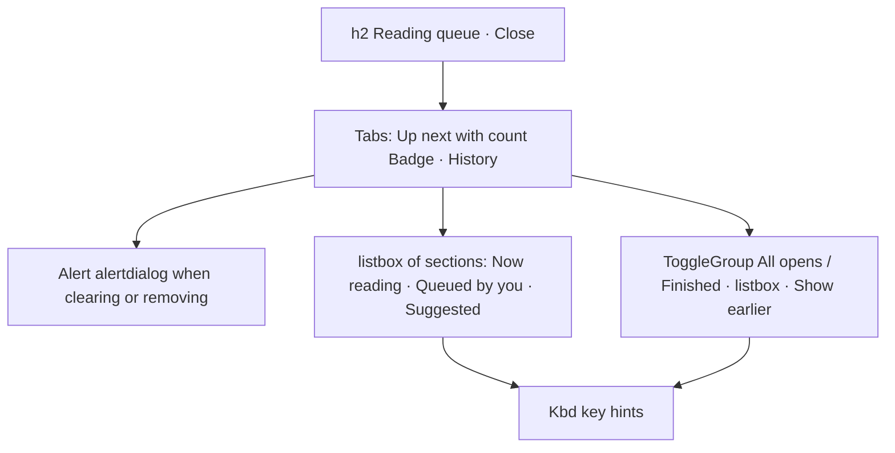

# Design sheet: Reading queue

The panel opens with `Space r` from any reading view. Source: `web/src/queue-panel.tsx`; `src/reader_mcp/web_ui/queue.mjs` owns state, requests and keys.

## Focused activity

**Decide what to read next, and get back to what you were reading.** *Up next* holds what you are reading now, your own queue (reordered with `J`/`K`) and suggestions with their reason. *History* lists what you opened, or only what you finished, so you can resume.

## Layout

On a phone the panel is a bottom sheet (the `.queue-panel` container in `web_ui/style.css`); on wider screens it is a right-hand panel, or the dock.

## Atomic composition

| Tier | Parts |
| --- | --- |
| Atoms (shadcn) | `Button`, `Badge`, `Progress`, `Kbd`/`KbdGroup`, `ToggleGroup`, `Tabs` |
| Atoms (icons) | row state: Play (now reading), the queue position, CircleCheck (finished), CircleDashed (started), Circle (not opened), CircleDot (suggested). These replace the ▶ ✓ ◐ · glyphs |
| Molecules | the row `Item` (`role=option`, `muted` when active): title, byline, reason with its voice Badge, progress, time, Changed, and Queue or Remove |
| Organisms | the section listbox (`aria-activedescendant`, so `j`/`k` move without moving focus); the confirm `Alert` |

## Test hooks

`#queue-panel`, `#queue-title`, `#queue-tab-next|history`, `#queue-list-next|history` (`[data-queue-list]`), `[data-section=<id>]`, `[data-section-label]`, `[data-queue-row][data-kind][aria-selected]`, `[data-queue-title]`, `[data-queue-byline]`, `[data-queue-reason]`, `[data-queue-time]`, `[data-queue-when]`, `[data-queue-action]`, `[data-queue-empty]`, `[data-queue-confirm]`, `#queue-confirm-yes`, `[data-queue-filter]`, `[data-queue-keys]`.
