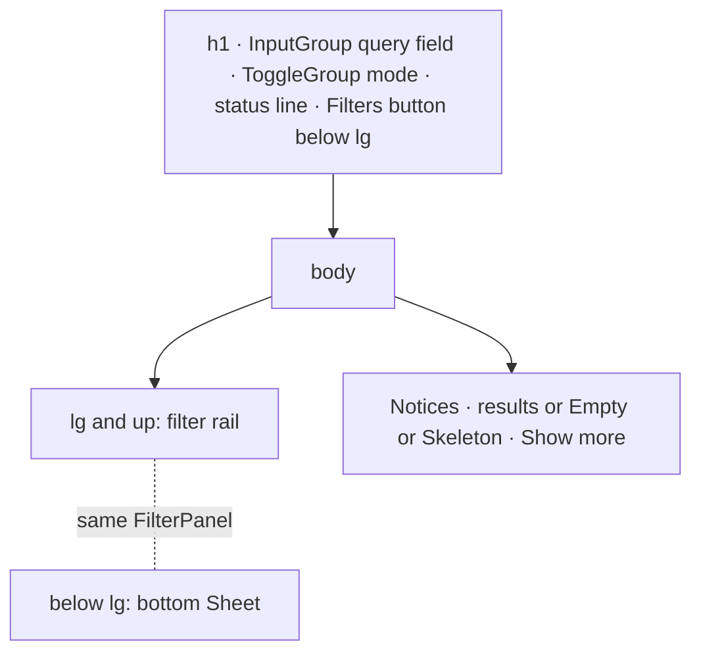

# Design sheet: Search

Routes `#search` and `#search=<query>`; `Space /` opens it. Source: `web/src/search-page.tsx`, with state in `src/reader_mcp/web_ui/search-page.mjs`.

## Focused activity

**Find the passage you half-remember, then open the document at it.** The page answers these questions in order:

1. What should I type, and how should it match: best blend, exact words, or meaning?
2. Which works matched, and where in each? Passages are listed under their work, with matches highlighted.
3. How do I narrow this down? Project, author and type facets, a date range, read state, folder, and whether machine files count.

`j`/`k` move between passages, `J`/`K` between works, Enter opens at the passage, and `q` queues the work.

## Layout

## Atomic composition

| Tier | Parts |
| --- | --- |
| Atoms (shadcn) | `InputGroup`, `InputGroupAddon` and `InputGroupInput`; `ToggleGroup` for mode, date presets and read state; `Checkbox`, `Switch`, `Input type=date`, `Badge`, `Button`, `Skeleton`, `Sheet` |
| Molecules | `FieldSet` + `FieldLegend` + horizontal `Field` per facet; folder `Item`s; passage `Item`s (button, `muted` when active); `Notice` for an incomplete or changed index; `EmptyState` for errors and no matches |
| Organisms | `FilterPanel` (the rail and the sheet share it), the work list |
| Template | the page column (`max-w-6xl`, `data-ui="shadcn"` opts into the slot preflight) |

Excerpts stay text nodes. Match highlights are CSS custom highlights (`::highlight(reader-search-term)`), never markup.

## Test hooks

`#search-query`, `#search-meta`, `[data-search-head]`, `[data-search-modes]`, `[data-search-mode]`, `[data-search-rail]`, `[data-search-sheet]`, `[data-filter-toggle]`, `[data-clear-filters]`, `[data-facet=<name>]`, `[data-facet-count]`, `[data-read-filter]`, `[data-search-results]`, `[data-work]`, `[data-work-title]`, `[data-passage]`, `[data-passage-label]`, `[data-excerpt]`, `[data-related]`, `[data-queue-add]`, `[data-state=error|none]`, `[data-search-empty]`.
