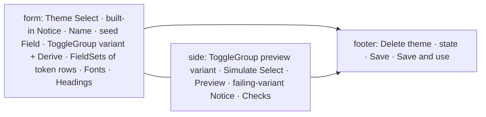

# Design sheet: Theme Editor

Opens with `F10`, `Space , t`, or *Theme Editor…* in Settings. Source: `web/src/theme/theme-editor.tsx`, with colour logic in `web/src/theme/color.ts`.

## Focused activity

**Make a light and dark theme of your own that stays readable.** Pick a starting theme, adjust tokens, fonts and heading styles, and watch the live preview. The contrast and colour-vision checks say what fails and offer fixes. Save to the vault, or save and use the theme straight away.

## Layout

At 1000px and up, the form and the side pane scroll independently in two columns; below that they stack. The Preview renders a sample article in the draft's tokens. Its styles are content (the article, its marks, the mode chips), not components.

## Atomic composition

| Tier | Parts |
| --- | --- |
| Atoms (shadcn) | `Select`, `Input`, `InputGroup` (colour swatch addon and hex input), `Slider` (alpha), `ToggleGroup`, `Badge`, `Button`, `Collapsible`, `Sheet`, `AlertDialog` |
| Atoms (theme) | `StatusBadge` (Pass = ok, Review = attention, Fail = error) |
| Molecules | token row (a two-column `Field`: label and description, then swatch and hex), heading row, font result `Item`, check `Item`, `Notice` |
| Organisms | Checks (a `Collapsible` per group, which opens again when a check starts failing); one `AlertDialog` for every confirmation (discard changes, replace a variant, delete a theme), in place of `window.confirm` |

## Test hooks

`#theme-editor`, `#theme-source`, `#theme-name`, `#token-<name>` and `[data-token=<name>]`, `[data-token-flag]`, `[data-token-group]`, `[data-theme-variant]`, `[data-theme-seed]`, `#font-search`, `[data-font-results] [data-font]`, `#heading-font-h<n>`, `#heading-size-h<n>`, `#theme-simulation`, `.theme-preview` (content), `[data-theme-checks] [data-severity]`, `[data-check-group]`, `#theme-editor-foot`, `[data-theme-confirm]`.
