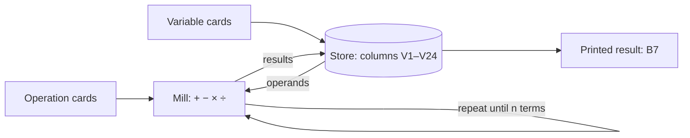

# Reading Note G as a program

## What the note sets out to do

[Note G](lovelace-note-g.md) ends the translator's notes with a worked example: the steps "through which the engine could compute the Numbers of Bernoulli," offered as "a rather complicated example of its powers." It is the longest single demonstration in the translator's notes, and the one most often quoted out of context.

## The mathematics in modern dress

Lovelace starts from the generating identity for the Bernoulli numbers,

$$
\frac{x}{e^{x}-1} = \sum_{n=0}^{\infty} B_n \frac{x^{n}}{n!},
$$

and derives a recurrence the Engine can follow one term at a time. In today's notation it is

$$
\sum_{k=0}^{n} \binom{n+1}{k} B_k = 0 \quad (n \ge 1), \qquad B_0 = 1.
$$

She numbers the non-zero odd-indexed terms $B_1, B_3, B_5, B_7$ and asks the Engine for $B_7$, which is $-\tfrac{1}{30}$ in her numbering (modern $B_8$).

## The same steps as code

```python
from fractions import Fraction
from math import comb

def bernoulli(n):
    b = [Fraction(1)]
    for m in range(1, n + 1):
        b.append(-sum(comb(m + 1, k) * b[k] for k in range(m)) / (m + 1))
    return b

print(bernoulli(8)[8])  # -1/30, Lovelace's B7
```

## How the Engine would run it



*Figure 1. The Store holds numbers, the Mill operates on them, and the cards say which columns to read and write. The loop is the part Lovelace calls a "cycle."*

## What I noticed

- **There is a bug.** In the published table, operation 4 divides $V_5$ by $V_4$ where the surrounding steps need $V_4$ by $V_5$. Readers have argued since about whether it was hers or the printer's.
- **The warning comes first.** Before any of this, the note opens by guarding against "exaggerated ideas" of what the Engine can do. The famous line, that it "has no pretensions whatever to originate any thing", is a caution, not a boast.
- **The table is the program.** Prose explains it, but the twenty-five rows are what would have been punched.

See also [Babbage's own account of the Engine](babbage-analytical-engine.md), written twenty years later and much less modest.
