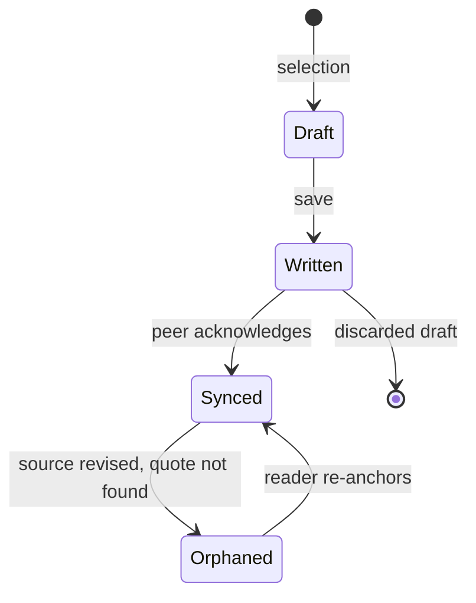

# ADR-007: Address highlights by their content

**Status:** Accepted · **Deciders:** Mira Okafor, Jonah Reyes

## Context

Highlights are created on several devices, sometimes offline for weeks. We need identifiers that two devices can agree on without talking to each other first.

## Decision

A highlight event's identifier is the SHA-256 of its canonical JSON bytes. Canonical means sorted keys, no insignificant whitespace, UTF-8, and timestamps in UTC with second precision.

```json
{"anchor":{"end":1824,"quote":"I went to the woods","start":1805},"edition":"9f2c…","kind":"highlight","parents":["41ab…"]}
```

## Lifecycle



## Consequences

- Duplicate delivery is free: the same bytes have the same name.
- Editing a highlight creates a new event that names the old one as a parent; nothing is mutated.
- We can never change the canonical form without a migration, so it is versioned from day one.
