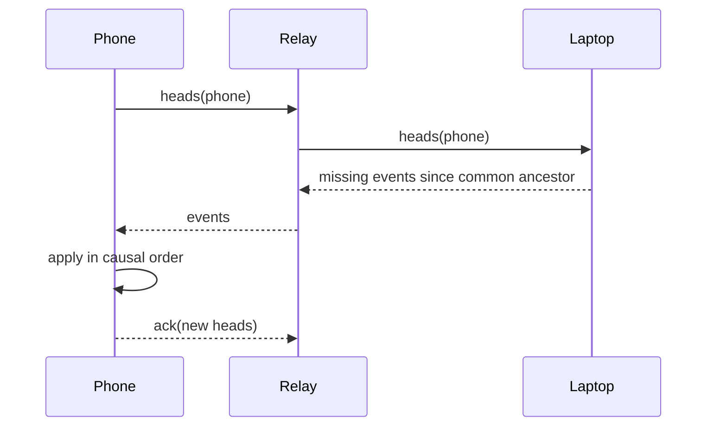
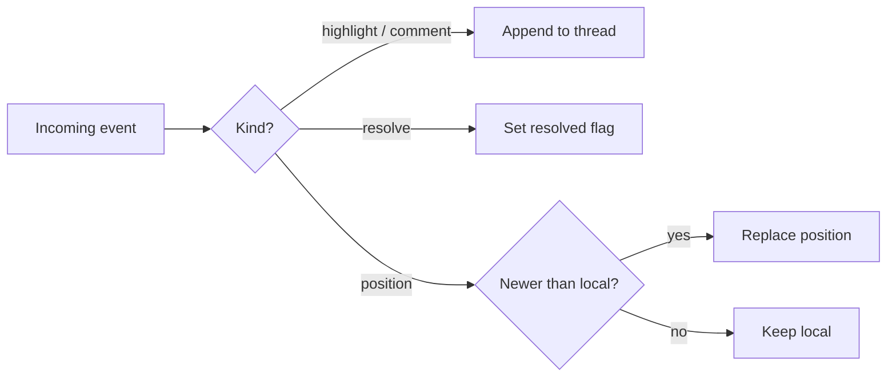

# Lantern sync: how highlights travel between devices

## Summary

Lantern keeps a reader's highlights, margin notes and reading positions on every device they use. Today each device is an island: a passage marked on the phone during the commute is missing from the laptop in the evening. This proposal describes a sync layer that works offline first, tolerates devices that are away for weeks, and never asks the reader to resolve a conflict they did not create.

The short version: every change is an immutable event, events are addressed by their content, and devices exchange the events the other side is missing. A reading position is the only value that is allowed to be overwritten.

## Goals

- A highlight made on any device appears on every other device within a minute when both are online.
- A device that has been offline for a month catches up without a full download.
- Two devices that annotate the same passage while apart both keep their work.
- The library on disk stays readable without Lantern: plain Markdown, plain JSON.

## Non-goals

- Real-time collaborative editing of a document's text. Lantern annotates; it does not edit sources.
- Sharing between different people. One reader, many devices.
- A hosted service. A relay may forward bytes, but it never needs to understand them.

## Background

The library is a folder of documents. Annotations live beside it in `annotations/`, one JSON file per thread, anchored to a passage by source offsets and a quote. Read receipts live in `engagement/`. Both formats were designed for a single machine and a single writer holding a file lock.

Three things break when a second device appears:

1. File locks do not cross machines.
2. Offsets drift when a source is revised on one device before the other has seen the revision.
3. "Last writer wins" silently discards a margin note written on a plane.

## Design

### Data model

Each change is an event. An event names its kind, the document edition it was made against (the SHA-256 of the source bytes), its anchor and its payload.

| Field | Type | Notes |
| --- | --- | --- |
| `id` | hash | SHA-256 of the canonical event bytes |
| `parents` | hash[] | Heads this device had seen when it wrote the event |
| `kind` | enum | `highlight`, `comment`, `resolve`, `position` |
| `edition` | hash | Source SHA-256 at the time of writing |
| `anchor` | object | Offsets plus the quoted text |
| `at` | time | Device clock, informational only |

Because an event's identity is its hash, the same event written twice is the same event. Duplicate delivery is harmless.

### Sync protocol

Devices exchange summaries of what they hold, then only the events the other side lacks.



*Figure 1. A catch-up round through a relay that forwards opaque bytes.*

The relay never decrypts events. It only needs to know which device asked for what.

### Conflict resolution

Highlights and comments never conflict: two devices that highlight the same passage produce two events, and both survive. Resolving a thread is a commutative flag. Only reading positions need a rule, and for those the most recent position by device clock wins, because a stale position costs the reader a few seconds of scrolling, not their work.



*Figure 2. Applying an event. Only positions can be replaced.*

### Retry and backoff

When the relay is unreachable, a device retries with exponential backoff and full jitter:

$$
t_n = \min\left(t_{\max},\; t_0 \cdot 2^{n}\right) \cdot U(0, 1)
$$

with $t_0 = 2\,\text{s}$ and $t_{\max} = 15\,\text{min}$. Retries continue until the relay answers.

```ts
async function syncLoop(device: Device, relay: Relay) {
  let attempt = 0;
  for (;;) {
    try {
      await device.exchange(relay);
      attempt = 0;
      await sleep(60_000);
    } catch (error) {
      attempt += 1;
      await sleep(backoff(attempt));
    }
  }
}
```

### Re-anchoring after a revision

When an event names an older edition than the one on this device, Lantern re-anchors it against the current text: exact quote first, then the quote with its surrounding context, then a fuzzy match within the same section. An anchor that cannot be placed is kept as an orphan with its quote, never moved to a guess.

## Failure modes

| Failure | Effect | Recovery |
| --- | --- | --- |
| Relay down | Changes queue locally | Backoff, then catch-up round |
| Device clock wrong | Positions may lose to older ones | Only positions use clocks |
| Source revised on one device | Offsets drift | Re-anchor by quote |
| Event file corrupted | Hash mismatch | Refetch by id from any peer |

## Rollout

1. Ship the event log behind a setting, writing alongside today's files.
2. Turn on relay sync for positions only.
3. Add highlights and comments once re-anchoring has a month of field data.

## Open questions

- Should the relay keep events at all, or only forward them while both devices are online?
- How long should an orphaned anchor be shown before it is filed away?
- Do reading positions belong in the same log, or in a separate, lossy channel?
