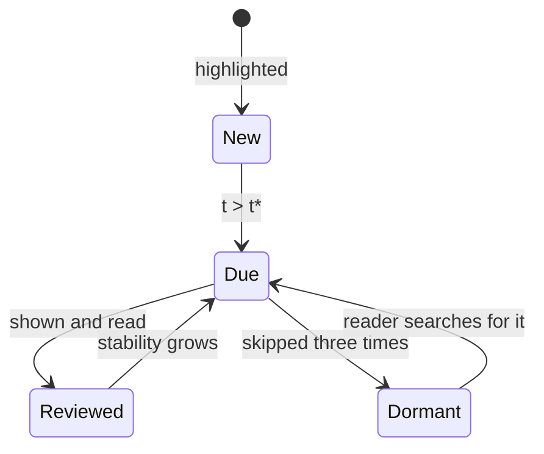

# Spaced re-reading: a scheduling model for highlights

## Why schedule rereading at all

A highlight is a promise to return. Most are never kept. Lantern already knows when each passage was marked and when it was last seen, so it can make a modest suggestion each morning: one passage you are about to forget, from a book you cared about.

This note proposes the model behind that suggestion. It is deliberately small: three parameters, no neural network, and every number on screen can be explained in a sentence.

## A model of forgetting

We treat the chance of recalling a passage as decaying exponentially with time since it was last seen:

$$
R(t) = e^{-t/S}
$$

where \(t\) is the time in days since the last review and \(S\) is the passage's *stability*, the number of days after which recall falls to \(1/e \approx 37\%\).

Each time a passage is seen again, stability grows, and it grows more when the review was harder, that is, when recall had already fallen further:

$$
S' = S \cdot \left(1 + \alpha \, (1 - R)^{\beta}\right)
$$

A review at the edge of forgetting is worth more than one made the next morning. This is the spacing effect in one line.

### Choosing what to show

Given a target recall $R^{*}$, the next review is due when $R(t) = R^{*}$:

$$
t^{*} = -S \ln R^{*}
$$

With $R^{*} = 0.8$ and a new highlight's stability of two days, the first resurfacing comes after $t^{*} = -2 \ln 0.8 \approx 0.45$ days, and later ones spread out quickly.

Over a reader's whole library, the expected number of passages recalled at time \(T\) is

$$
\mathbb{E}[N(T)] = \sum_{i=1}^{n} \exp\!\left(-\frac{T - \tau_i}{S_i}\right),
$$

and Lantern picks the passage whose review would raise that sum the most per minute of reading.

## Parameters

| Symbol | Meaning | Starting value |
| --- | --- | --- |
| $S_0$ | Stability of a new highlight | 2 days |
| $\alpha$ | Growth per review | 1.6 |
| $\beta$ | Difficulty exponent | 0.8 |
| $R^{*}$ | Target recall | 0.8 |

## A reference implementation

```python
import math

def recall(days, stability):
    return math.exp(-days / stability)

def review(stability, days, alpha=1.6, beta=0.8):
    r = recall(days, stability)
    return stability * (1 + alpha * (1 - r) ** beta)

def due_in(stability, target=0.8):
    return -stability * math.log(target)
```

## How a highlight moves through the schedule



*Figure 1. States of a highlight. Skipping is information too: three skips put a passage to sleep rather than nagging.*

## Limits

The exponential curve is a convenience, not a law; real forgetting curves have heavier tails. Recall is never observed directly. Lantern only sees whether a resurfaced passage was opened, read to the end, or dismissed. Treat the schedule as a polite guess.

## Further reading

The scheduling problem echoes an older one. Montaigne, rereading his own books, admitted that he forgot what he had written in their margins; see [Of Books](../../essayists/montaigne/of-books.md). The sync design that carries these review events between devices is in [Lantern sync](../design/sync-design.md).
