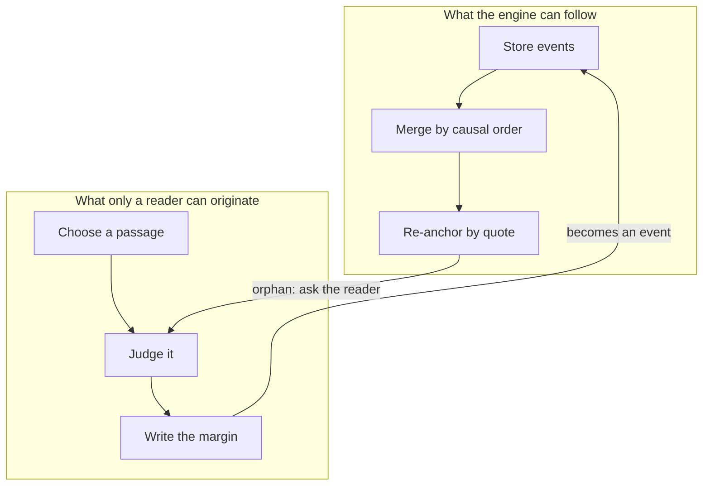

# The engine and the essay

## Two kinds of work

[Note G](../analytical-engine/lovelace-note-g.md) separates the Engine's powers into two: it can *follow* analysis, and it cannot *originate* anything. That is an architectural statement before it is a philosophical one. It tells you where the boundary of the machine is, and therefore what has to stay on the human side of it.

*Figure 1. The boundary in [Lantern sync](../lantern/design/sync-design.md). Everything above the line is mechanical and can be retried; everything below it is authored and must never be guessed.*

## Where systems go wrong

Most sync bugs I have seen are a machine crossing that line: deciding which of two notes "really" belongs to a passage, or moving a highlight to the nearest plausible sentence. Each of those is the engine pretending to originate.

Montaigne's essays are the opposite case: pure origination, no procedure at all. He says so himself in [Of Idleness](../essayists/montaigne/of-idleness.md): left idle, his mind "creates me so many chimaeras and fantastic monsters" that he began to write them down. You cannot sync that. You can only keep it safe.

## The operating rule

When a step can be retried without asking anyone, put it in the engine. When it cannot, stop and hand it back. A queue of orphaned anchors waiting for a reader is not a failure of the design. It is the design.
